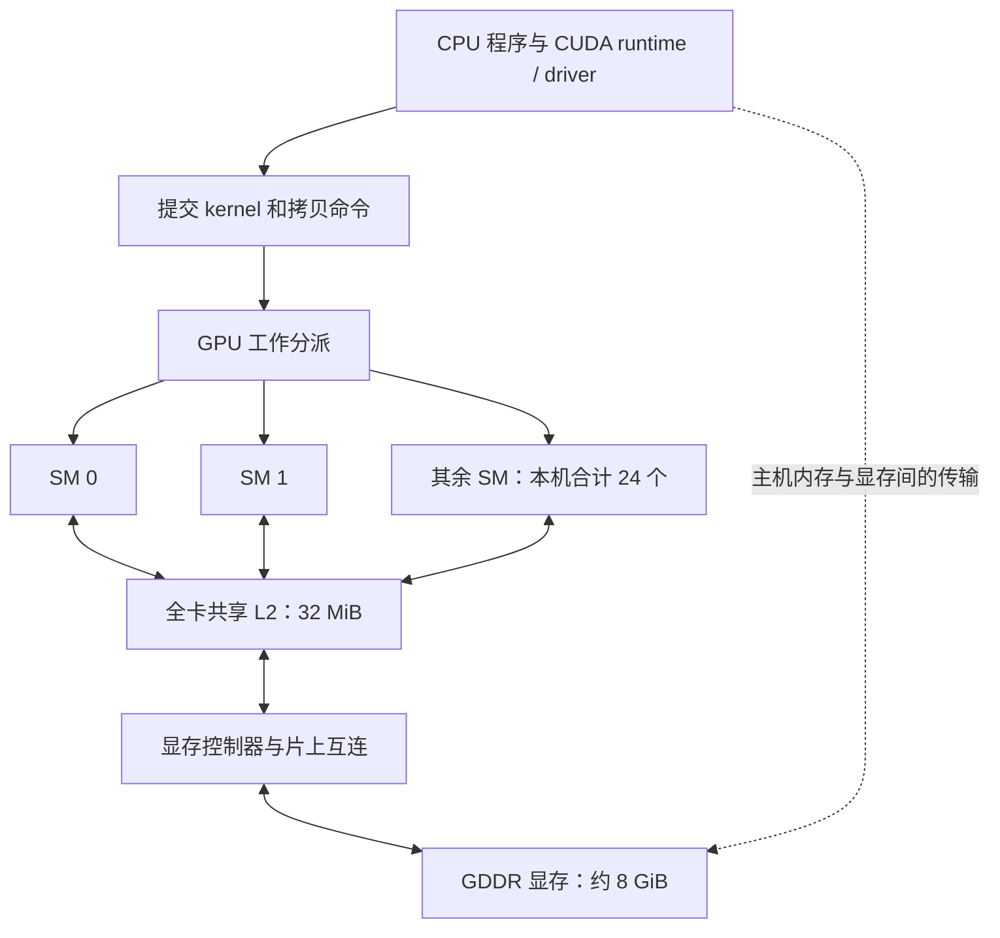
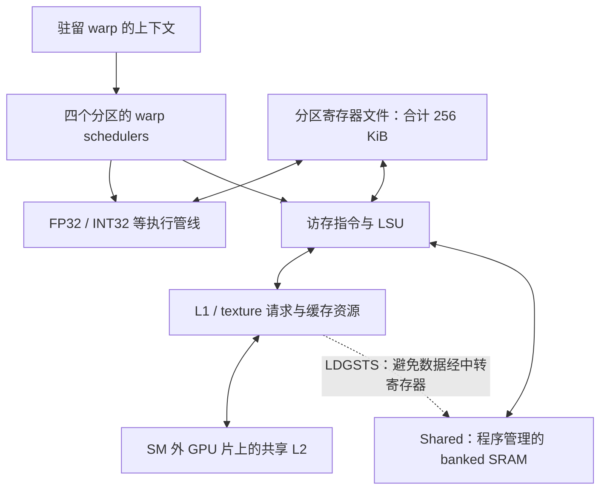
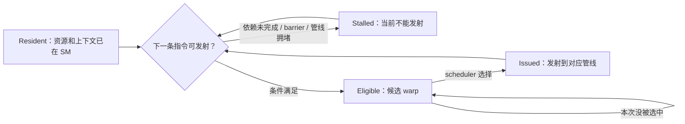

# 从手写 GEMM 理解 GPU 架构

这份讲解以本项目的 RTX 4060 Laptop、Ada SM 8.9、FP32 GEMM 为背景，连接源码、PTX、SASS 和 Nsight Compute。目标是让你看到一段 kernel 后，可以回答：谁在执行，数据在哪里，一条指令要求谁等待，以及一个优化究竟节省了什么。

架构范围：2026-10-23 整理；本机静态属性采用 [CUDA 设备快照](results/published/device/device-info.json)。容量、指令吞吐、缓存策略和同步机制会随架构变化。本文的普通 SIMT/FP32 路径不要直接套到 Hopper/Blackwell 的 TMA、WGMMA 或更新的 Tensor Core 路径。

建议先顺序读到第 9 部分，再用后面的 GEMM 推导和阅读路线查漏补缺。需要单独查设备数字时用 [GPU_DEVICE.md](GPU_DEVICE.md)，查现有测量时用 [实验索引](results/published/README.md)。

接下来可按 [NCU 与 CUTLASS CuTe 四天学习路线](NCU_CUTLASS_CUTE_STUDY_GUIDE.md)，把这里的架构知识用于性能报告分析和布局抽象练习；包含三天压缩版与本项目的真实案例。

## 阅读导航

1. [先区分地址空间和缓存层级](#memory-model)
2. [本机 GPU 从整卡到 SM](#hardware)
3. [数据实际怎样搬运](#data-paths)
4. [源码 PTX SASS 和寄存器](#instructions)
5. [Warp 的 global 合并访存](#coalescing)
6. [Shared bank conflict 的完整判断方法](#banks)
7. [Block warp thread 的映射和上下文](#execution)
8. [驻留 调度 occupancy 和 stall](#scheduling)
9. [同步与内存可见性](#synchronization)
10. [把 GEMM 参数翻译成资源和复用](#gemm-model)
11. [软件预取 双缓冲 硬件异步](#pipelining)
12. [如何阅读 NCU 和 Roofline](#profiling)
13. [数值 编译和测量中的其他关键问题](#other-topics)
14. [项目各阶段解决了什么](#project-map)
15. [官方资料阅读路线](#reading)
16. [用当前代码做自检](#exercises)

<a id="memory-model"></a>

## 1 先区分地址空间和缓存层级

### 1.1 GPU 内存不是一条 global 到 shared 到 register 的必经链

这里有两组不同的概念：

- **地址空间和显式存储资源**：global、shared、local、constant、register。它们决定变量放在哪里、谁能访问、存活多久，以及使用什么访问指令。
- **缓存层级**：L1、L2。它们保留某些内存地址的数据副本，减少后续请求访问更远存储的代价。

所以，`shared` 不是 global 的下一层自动缓存；register 也不是 L1 的另一个名字。你不写 shared tile，普通 global load 一样可以把数据送进寄存器；你写了 shared tile，通常是自己安排加载、存储、复用和同步。

CPU 的 `DRAM → LLC/L3 → L2 → L1 → register` 也只是普通缓存访问的教学示意，不能理解成每个值必须逐级新存一份、每种指令都采用完全相同的路径。命中位置、缓存分配和非临时访问策略都会影响数据流。GPU 同样有缓存层级，只是 CUDA 还暴露了程序员可管理的 shared 等存储资源。CPU 的非临时存储可查 [Intel 软件开发手册](https://www.intel.com/content/www/us/en/developer/articles/technical/intel-sdm.html) 中 MOVNT 系列指令。

### 1.2 各种存储的作用域

| 名称 | 本项目中的物理位置或实现 | 谁能使用 | 谁管理内容 | GEMM 中的例子 |
|---|---|---|---|---|
| Global memory | `cudaMalloc` 分配的显存；请求可能命中缓存 | 有合法指针的 GPU 线程 | 程序分配和读写 | A、B、C |
| L2 | GPU 片上的共享缓存 | 各 SM 的请求通过它服务 | 硬件缓存管理，部分策略可配置 | 不同 block 重读 A/B 时复用 |
| L1/texture cache | 每个 SM 内的缓存资源 | 该 SM 的相关访存请求 | 硬件，受指令策略影响 | 普通 global/local load 的缓存命中 |
| Shared memory | 每个 SM 的片上 SRAM 资源 | 本机普通 kernel 中，同一 block 的线程 | 程序显式读写和同步 | As、Bs |
| Register file | SM 内分区的寄存器存储 | 每线程有自己的寄存器值 | 编译器分配，硬件保存上下文 | 累加器、atmp、btmp、地址 |
| Local memory | 线程私有地址空间，后备存储在 device memory，可被缓存 | 对应线程 | 编译器生成访问 | 溢出的寄存器、无法放入寄存器的数组 |
| Constant memory | 只读地址空间及相应缓存路径 | device 端读取；host 等接口更新 | 程序/编译器与缓存硬件 | 一些常量和参数相关读取 |

**Local 表示线程私有，不表示物理距离近。** `float temp[100]` 写在函数体里，不保证就是 100 个硬件寄存器。**Shared 表示 block 内共享，不表示所有 SM 都能直接寻址它。** 同一 SM 上两个 block 的 shared 分配也彼此隔离。[CUDA 内存空间说明](https://docs.nvidia.com/cuda/archive/13.2.0/cuda-programming-guide/02-basics/writing-cuda-kernels.html)

### 1.3 地址 可见性 一致性是三件事

一个 global 地址可被多个线程访问，不代表这些线程可以无同步地读写它。指针合法、数据缓存在哪里、写入何时对另一个线程可见，需要分别判断。

UVA 是统一虚拟地址；Unified Memory 是带有放置/迁移等管理机制的内存功能；L1/L2 是缓存。三者都不等于“CPU 和 GPU 共用一块无访问代价的内存”。本项目 A/B/C 在 kernel 计时前已放入 GPU 显存，CPU↔GPU 的 PCIe 传输不在 benchmark 的计时范围内。[CUDA Unified and System Memory](https://docs.nvidia.com/cuda/archive/13.2.0/cuda-programming-guide/02-basics/understanding-memory.html)

<a id="hardware"></a>

## 2 本机 GPU 从整卡到 SM

### 2.1 整卡的逻辑结构



这是计算相关的逻辑关系图，不是芯片布线图。实际 GPU 还按 GPC/TPC 组织 SM，并有 L2 分片、多个内存控制器、指令缓存、纹理和图形单元。对当前 GEMM，先关注 SM 内的资源和 SM 到 L2/显存的流量。Ada 白皮书主要用 AD102 等芯片展示整卡，不能把其中的 SM 数直接当成本机数字。

### 2.2 一个 Ada SM 内部有什么

Ada SM 分成四个处理分区。每个分区有 warp scheduler、寄存器资源和执行管线。整 SM 合计 128 个 FP32 执行通道；每分区包含 FP32 专用通道和可执行 FP32/INT32 的通道。LSU 负责访存指令相关工作，另外还有特殊函数、Tensor Core 等执行资源。[Ada 架构白皮书，SM 图及内存子系统](https://images.nvidia.com/aem-dam/Solutions/geforce/ada/nvidia-ada-gpu-architecture.pdf)



图中 L1 与 shared 为便于解释分开画；Ada 的 L1/texture/shared 使用 **128 KiB 的统一资源池**，shared carveout 最大为 100 KiB。寄存器文件是另一份资源，不能把“空闲的 shared”直接变成更多寄存器。`BYPASS L1` 指缓存策略，不表示 LSU/L1TEX 请求处理硬件完全不参与。[Ada Tuning Guide](https://docs.nvidia.com/cuda/ada-tuning-guide/)

### 2.3 本机需要记住的数字

| 资源 | 本机数值 | 作用域 |
|---|---:|---|
| SM | 24 | 全卡 |
| Warp 大小 | 32 threads | 每 warp |
| 最大驻留 warp / thread | 48 / 1536 | 每 SM |
| 最大驻留 block | 24 | 每 SM；实际受其他资源先限制 |
| 最大线程数 | 1024 | 每 block |
| 寄存器 | 65536 个 32-bit，即 256 KiB | 每 SM |
| Shared 上限 | 100 KiB | 每 SM |
| Shared 默认 / opt-in 上限 | 48 / 99 KiB | 每 block |
| Driver 保留 shared | 1 KiB | 每 block，本机查询值 |
| L2 | 32 MiB | 全卡 |

来源是项目的 [设备快照与字段解释](GPU_DEVICE.md)。这些是资源容量或上限，不是每周期执行量。`48 个驻留 warp` 不等于一个周期执行 48 条 warp 指令；`3072 CUDA cores` 也不等于 GPU 只能创建 3072 个线程。

<a id="data-paths"></a>

## 3 数据实际怎样搬运

### 3.1 Global 到寄存器

```cpp
float av = a[row * k + col];
```

典型步骤是：计算地址 → 发出 global load → 把活跃 lane 的地址组成请求 → 查询适用缓存 → 必要时到 L2/显存取数据 → 返回各线程的目标寄存器。global load 命中 L1 或 L2 时，不需要每次去 GDDR。

`a[...]` 是 global 地址访问，不是“保证访问显存芯片一次”。`LDG` 的目标寄存器存在，并不意味着数据在发射那一刻已经就绪；依赖它的后续指令要等到数据可用。

### 3.2 Global 到 shared 的普通路径

```cpp
As[ty][tx] = a[offset];
```

概念上通常对应：

```text
global 地址 → 缓存/显存 → LDG 的临时寄存器 → STS → shared
```

源码是一条赋值，不代表一条机器指令。向量化时可以是 `LDG.128` 接 `STS.128`；若要把一行四个 float 转置到四个分散的 shared 地址，可能是 `LDG.128` 接四条标量 `STS`。

### 3.3 Shared 到寄存器再计算

```cpp
float av = As[t][local_row];
float bv = Bs[t][local_col];
acc += av * bv;
```

典型 SASS 是 `LDS` 取操作数，然后 `FFMA` 更新累加器。普通 FP32 `FFMA` 使用寄存器操作数；它不会直接拿 `As` 数组地址执行乘加。shared 的优势是数据已经在 SM 旁边，并能被 block 内多个线程复用，不是免去了所有加载指令。

寄存器到 shared 用 `STS`；寄存器到 global 用 `STG`。普通 shared→global 搬运可由 `LDS → register → STG` 实现。各路径仍受指令、端口、队列和带宽限制。

### 3.4 Global 到 shared 的硬件异步路径

本机支持的 `cp.async` 在 SASS 中可出现为 `LDGSTS`：直接把 global 数据放入 shared，避免普通 `LDG → 数据寄存器 → STS` 的中转。地址寄存器和管理拷贝的指令仍然需要。

本项目当前 `asyncpipeline` 的 A/B 路径不同：

| 数据 | 当前路径 | 原因 |
|---|---|---|
| A | `LDG.128 → nextA → 四条 STS` | 在 shared 中转置，目标地址不连续 |
| B | `LDGSTS...128 → Bs` | 一次拷贝的四个 float 在源和目标都连续 |

`LDGSTS` 支持 4/8/16 Byte 的单线程拷贝；16 Byte 路径可采用 L1 bypass。它不自动执行任意转置，也不自动保证下一句使用的数据已到达；需要配套等待机制和必要的线程间同步。[CUDA 异步拷贝](https://docs.nvidia.com/cuda/archive/13.2.0/cuda-programming-guide/04-special-topics/async-copies.html)

### 3.5 还有哪些路径容易混淆

- `__shfl_sync` 允许一个 warp 的 lane 交换寄存器中的值。它不是让线程得到另一个线程的寄存器指针，也不是 shared load。
- Local load/store 可能是寄存器溢出。它们仍可能经过缓存并触及显存，不属于 shared。
- Constant 读取很适合同一 warp 使用相同地址的情况；多个不同地址不能简单当作一次免费广播。
- Host↔device 的 `cudaMemcpyAsync` 与 SM 内的 `cp.async` 是不同层级的异步；设备的 `asyncEngineCount` 不能用来计算 warp 能发多少 `LDGSTS`。
- 本机 Ada 没有 Hopper 的 TMA 和 thread block cluster 的 distributed shared memory。不要照搬新架构中的跨 SM shared 图。

相关语义见 [CUDA 语言扩展](https://docs.nvidia.com/cuda/archive/13.2.0/cuda-programming-guide/05-appendices/cpp-language-extensions.html) 和 [CUDA 异步执行](https://docs.nvidia.com/cuda/archive/13.2.0/cuda-programming-guide/02-basics/asynchronous-execution.html)。

<a id="instructions"></a>

## 4 源码 PTX SASS 和寄存器

### 4.1 三层表示各回答什么问题

```text
CUDA C++：算法、线程映射、数组和同步意图
    ↓ 编译优化
PTX：虚拟指令集、虚拟寄存器和地址空间
    ↓ ptxas 或驱动 JIT
SASS：指定 GPU 架构的机器指令和物理资源分配
```

PTX 中 `%f182` 不代表每线程至少用了 183 个物理寄存器。SSA 风格的中间值可以复用同一个硬件寄存器；一些值可能被消除。每线程实际寄存器数看 ptxas、资源报告或 NCU Launch Statistics。

源码 `float4` 表示四个 float 组成的类型；是否发出宽访存指令，要看对齐、使用方式和最终 SASS。SASS 的 `LDG.128` 是每线程 128 bit 加载，通常写入连续四个 32-bit 寄存器；不是“整个 warp 总共读 128 bit”。宽访存也不等于把这个线程的四次浮点运算变成一条四路算术指令。[PTX ISA](https://docs.nvidia.com/cuda/parallel-thread-execution/)；[CUDA Binary Utilities](https://docs.nvidia.com/cuda/cuda-binary-utilities/)

### 4.2 当前 GEMM 常见指令

| SASS | 在当前分析中的含义 | 常见源码来源 |
|---|---|---|
| `LDG / STG` | global 读 / 写 | A/B 读取、C 写回 |
| `LDS / STS` | shared 读 / 写 | As/Bs 的使用与填充 |
| `LDGSTS` | global→shared 异步数据搬运 | B 的 `cuda::memcpy_async` |
| `FFMA` | 融合乘加，通常按 2 FLOP 计 | `acc += a * b` |
| `IMAD / IADD3 / LEA` | 整数与地址计算 | 行列偏移、循环地址递增 |
| `ISETP` | 比较并设置谓词 | 尾部判断、循环判断 |
| `BRA / BSSY / BSYNC` | 分支与控制流汇合相关 | if、循环、发散路径 |
| `BAR.SYNC` | block barrier | `__syncthreads()` |
| `WARPSYNC` | warp 范围同步 | 显式同步或编译器需要的汇合 |
| `LDGDEPBAR / DEPBAR` | 当前异步拷贝的分组与等待 | commit / wait |

这些是当前架构常见对应，不是所有 CUDA 版本都一一对应的源码翻译表。尤其 **BSYNC 不等于 `__syncthreads()`**。某条指令还可能带有正文未打印的依赖等待位；只数助记符不能解释所有 stall。

### 4.3 R 寄存器不是所有线程共享同一个值

`FFMA R8, R2, R3, R8` 是 warp 指令，但每个参与 lane 使用自己的 R2/R3/R8。线程的寄存器上下文在物理寄存器文件中分开保存。

`R` 通常表示每线程的数据寄存器，`P` 是谓词；SASS 还可能出现 `UR/UP` 等 uniform 状态。它们与 shared bank 不是同一件事。不能对 `R8` 取 `%32` 来判断 shared bank conflict。

### 4.4 为什么几个局部变量会变成很多寄存器

寄存器除了累加器，还保存 A/B 临时值、地址、循环状态、谓词相关值和预取数据。分配取决于**同时存活的值**，不是变量声明的数量。

循环展开、预取距离增加，会让更多值同时存活。数组索引若能在编译时确定，编译器容易把数组拆成独立寄存器；运行时索引、取地址或资源压力则可能导致 local memory。强行降低 `maxrregcount` 可能引入 spill，并不保证提速。

<a id="coalescing"></a>

## 5 Warp 的 global 合并访存

### 5.1 硬件看到的是一组 lane 地址

对一条 warp 访存指令，活跃 lane 各自给出地址。硬件将这些地址覆盖到的存储区域组织成请求。对本机这类现代 GPU，global 合并效率常用覆盖的 **32 Byte sector** 分析。请求、sector、cache line、DRAM 总线事务不是同一层的计数。[CUDA Best Practices 的合并访存](https://docs.nvidia.com/cuda/cuda-c-best-practices-guide/index.html#coalesced-access-to-global-memory)

假设满 warp、标量 float、基址按 32 Byte 对齐：

| lane 的 float 索引 | 有效请求字节 | 覆盖 sector | 含义 |
|---|---:|---:|---|
| `lane` | 128 B | 4 | 连续合并访问 |
| `lane + 1` | 128 B | 5 | 偏移导致跨额外 sector |
| `8 * lane` | 128 B | 32 | 每 lane 只使用一个 sector 中的 4 B |
| 全部为 `0` | 同一个 4 B 值 | 1 | 多 lane 读取同一地址，可复用请求 |

缓存命中可以降低访问更下层存储的次数，但不会把糟糕的 lane 地址布局自动变成更少的上层请求工作。

### 5.2 为什么 x 对应 col 有效

二维 block 的线程线性编号是：

```cpp
tid = threadIdx.x + blockDim.x * threadIdx.y;
lane = tid % 32;
warp_id = tid / 32;
```

当 `blockDim.x=32`，一个 warp 内 x 递增、y 相同。row-major 的 `B[k][col]` 在 col 方向连续，所以 x→col 往往让 B load 与 C store 更容易合并；同一行计算中的 A 元素则可能被多个 lane 读取同址。

但这不是“thread 本身也 row-major 存数据”。是 **CUDA 线程线性化顺序**与**你选定的数据地址公式**配合得好。`blockDim.x=16` 时，一个 warp 跨两个 y；是否连续，要把实际地址算出来。对于只用扁平 tid 的映射，`block=(128,1)` 和 `(16,8)` 可能得到相同 lane 分工；对于直接用 x/y 计算坐标的 kernel 则未必。

### 5.3 float4 改变的是每线程一次请求的宽度

```cpp
float4 v = *reinterpret_cast<const float4*>(a + 4 * tid);
```

在满足对齐和完整访问条件、且生成 `LDG.128` 时，每线程一次读取连续四个 float。满 warp 总计 512 B，连续布局覆盖 16 个 32 B sector。数据总量没有凭空减少，收益通常来自更少的 load 指令、地址计算和相关调度开销。

“每线程读取 4 个”与“32 个线程合并成少量请求”是两个维度，可以同时成立。`__align__(16)` 保证声明对象的起始对齐；不能保证 `base + arbitrary_offset` 也对齐。row-major 下还要检查行步长、列偏移、边界，不能让 float4 跨越分配末尾。

<a id="banks"></a>

## 6 Shared bank conflict 的完整判断方法

### 6.1 Bank 属于 shared 硬件 访问组合来自 warp

本机 shared 按 32 个 bank 组织，连续的 32-bit word 映射到连续 bank。对 float 可写成：

```text
bank = (byte_address / 4) % 32
     = float_word_index % 32
```

**Bank conflict 不是 warp 固有的属性，也不是矩阵固有的属性。** 它来自某条 shared 访存指令中，参与 lane 的地址，在一次服务所需的分解下，对同一 bank 提出了多个不同 word 的访问。

要同时知道：指令读还是写、每线程宽度、活跃 lane、各 lane 完整地址，以及请求如何分成必要的 wavefront。两个不同 warp 竞争 shared 吞吐属于资源竞争，不能直接算成同一 warp 的 N-way conflict。

本文的 bank conflict 特指 shared；global 的 sector 合并、显存控制器内部的 DRAM bank，是其他层面的概念。[Shared 访问模式](https://docs.nvidia.com/cuda/archive/13.2.0/cuda-programming-guide/02-basics/writing-cuda-kernels.html#shared-memory-access-patterns)

### 6.2 标量 load 的几个可手算例子

假设同一条标量 shared load、满 warp、float 数组 `s`：

| 访问 | Bank 分布 | 结果 |
|---|---|---|
| `s[lane]` | 0…31 | 无冲突 |
| `s[2*lane]` | 0,2,…30 重复两遍 | 2-way，不同 word |
| `s[4*lane]` | 0,4,…28 重复四遍 | 4-way，不同 word |
| `s[32*lane]` | 都是 0，但地址各不相同 | 32-way |
| `s[7]` | 同 bank、同 word | 读取广播，无上述冲突 |

对满 warp、每 lane 一个不同 float word、固定非零 stride 的这个简化模型，冲突度可用 `gcd(stride,32)` 推导。它不能直接套到重复地址、部分活跃 lane 或向量指令。

多个 lane **写同一个地址**不是读广播的安全替代品：不受控并发写有数据竞争。即使结果偶然相同，也不能用它建立算法正确性。

### 6.3 为什么一条 STS.128 不自动产生 4-way conflict

看以下两种写法，并以实际生成的 SASS 为前提：

```cpp
// 若生成四条标量 STS：分别分析每一条
s[4 * lane + 0] = v.x;
s[4 * lane + 1] = v.y;
s[4 * lane + 2] = v.z;
s[4 * lane + 3] = v.w;

// 若生成一条 STS.128：按宽请求的必要分解分析
*reinterpret_cast<float4*>(&s[4 * lane]) = v;
```

四条标量指令中，每一条都是 stride 4；满 warp 下各有 4-way 冲突。

一条宽指令若是满 warp 各读写不重叠、连续的 16 B，总共 512 B，理想服务本来就需要多个 wavefront。可以用连续 8 个 lane 的 128 B 数据块理解：这 8 个 lane 的四个 word 正好覆盖 32 个 bank。四个必要的 128 B 分片不等于额外的 4-way 冲突。

因此，你说“一个线程的数据分布到四个 bank”在该布局中是对的；还必须结合**是哪一条指令、分到哪个服务片段**。不要把 128 个 word 一次性挤进 32 个 bank 的纸上统计，当成硬件必然的四倍冲突。

NCU 应比较 **actual 与 ideal wavefronts，以及 excessive wavefronts**。有广播、部分活跃线程或不同布局时，宽指令的 ideal 也会变，不能规定所有 `LDS.128` 的 ideal 都为 4。[NCU 内存指标](https://docs.nvidia.com/nsight-compute/ProfilingGuide/index.html#memory-tables)

### 6.4 本项目转置 A 的 4-way 是怎么来的

默认 `BM=64, BK=16`，每线程读取连续四个 A 元素，再转置写入 `As[k][m]`。先看第 0 个 warp 的第一个 slot，令 `l=lane`：

```text
element   = 4*l
local_row = floor(l/4)
local_col = 4*(l%4)

As[local_col+j][local_row] 的 float 地址
  = (4*(l%4)+j)*64 + floor(l/4)

bank = floor(l/4) % 32
```

对固定 `j` 的一条标量 STS，lane 0～3 都命中 bank 0，但访问不同的 k 行，地址不同；lane 4～7 同理。于是出现 4-way。

但计算时的 As 读取换成了另一组地址公式，还有同址广播和宽 LDS；不能因为“写 As 有 4-way”就断定“读 As 也有 4-way”。现有 hybrid NCU 中，A 的转置写入 actual/ideal 为 4，而计算阶段的 As/Bs 读取没有额外 wavefront。这个结论对应该次编译和参数，不是转置矩阵的永久属性。

### 6.5 Padding swizzle 和向量化要一起考虑

`tile[32][33]` 是经典 padding：改变行步长，从而改变跨行访问的 bank 映射。但增加一列可能破坏行首的 16 Byte 对齐，使原来的宽 load/store 退化。

Swizzle 用逻辑坐标到物理地址的置换改变 bank 分布；读写两侧必须一致，还要保留适合向量化的连续子块。减少冲突的收益可能被更多地址计算、寄存器和更低驻留率抵消。这正是 `doublebuffer_opt` 需要单独测量的原因。

<a id="execution"></a>

## 7 Block warp thread 的映射和上下文

### 7.1 软件对象与硬件资源不是一一对应

| 概念 | 含义 | 不应理解成 |
|---|---|---|
| Grid | 一次 kernel launch 的 block 集合 | 所有 block 必须同时存在于 SM |
| Block / CTA | 一组可使用共同 shared 和 block barrier 的线程 | 一个 CUDA core 或一个固定物理电路 |
| Warp | 同一 block 按线程线性编号划分的 32-thread 组 | 一个矩阵行，或一个 CPU 线程 |
| Thread / lane | 逻辑线程及其在 warp 内的位置 | 独占一个 FP32 core 的永久实体 |
| SM | 保存多个 block/warp 上下文并执行指令的硬件集合 | 只执行一个 block 的核心 |

普通 kernel 中，一个 block 获得资源后在一个 SM 上执行；其 warp 不会为了分摊负载散到多个 SM。不要依赖 block 的执行先后顺序或它落在哪个 SM。warp 的 lane 也不会因为数据是 row-major 就自动知道矩阵行列。[CUDA 线程层次](https://docs.nvidia.com/cuda/archive/13.2.0/cuda-programming-guide/01-introduction/programming-model.html)

### 7.2 GPU 保存了什么上下文

线程有寄存器值、谓词和执行状态；warp 有调度/控制流相关状态；block 有 shared 分配和同步状态。它们占据片上硬件资源。

**驻留**表示这组上下文和所需资源已经在 SM 上分配，因此可以等待或执行。一个 warp 等内存时，它的寄存器不会因为暂时不发射指令就立即释放给另一个 block。

SM 在已经驻留的 warp 之间选择，不需要像操作系统切换普通软件线程那样，为每次选择把整套上下文保存到 DRAM。它也不代表所有上下文都没有容量限制。

### 7.3 SIMT 与 CPU SIMD 的对应

CPU SIMD 常在程序里显式操作一个向量寄存器；CUDA 通常让你写一个标量线程，硬件按 warp 组织相同指令的多 lane 执行。SIMT 的 lane 可以有不同地址、不同谓词和不同控制流状态。

同 warp 分支条件不一致时，硬件需要让不同路径的 lane 分组执行或使用谓词。只剩 8 个 lane 参与一条指令时，其余 lane 不会自动填入别的 warp 的线程来补满。

Volta 之后支持 Independent Thread Scheduling，不能依赖“同 warp 天然永远锁步”来代替必要同步。它也不等于 32 个完全独立、各有完整 CPU 前端的标量核心。编译器与硬件仍以 SIMT 分组执行。[CUDA SIMT 模型](https://docs.nvidia.com/cuda/archive/13.2.0/cuda-programming-guide/03-advanced/advanced-kernel-programming.html#simt-execution-model)

与 CPU 类比时，可以这样抓重点：现代高性能 CPU 通常用复杂的乱序执行、预测和缓存降低单线程等待；GPU 更依靠编译器安排的独立指令与多个驻留 warp 持续提供工作。这是设计侧重点，不表示 CPU 没有多线程或 GPU 没有缓存。

<a id="scheduling"></a>

## 8 驻留 调度 occupancy 和 stall

### 8.1 从驻留到执行要经过哪些条件



Ada 的四个 scheduler 各自管理所属分区的驻留 warp，不是每个 scheduler 都从整个 SM 的 48 个 warp 中任意挑选。

warp 的状态随指令推进反复变化。**Stall 是暂时不能发射下一条指令，不是程序报错，也不是整个 GPU 停住。** 另一个驻留且 eligible 的 warp 可能继续执行。[CUDA 硬件多线程](https://docs.nvidia.com/cuda/archive/13.2.0/cuda-programming-guide/03-advanced/advanced-kernel-programming.html#hardware-implementation)

如果大量 warp 都在等同一类资源，再高的驻留数量也不保证有足够 eligible warp。反过来，有较多独立计算的 warp 可能以不高的 occupancy 持续提供工作。

### 8.2 Occupancy 是资源占用比例

```text
理论 occupancy = 每 SM 可驻留 warp 数 / 本架构每 SM 最大驻留 warp 数
```

本机分母是 48。它既不是有效 lane 比例，也不是 SM 覆盖率，更不是 FP32 峰值利用率。

Achieved occupancy 是执行期间实际活跃 warp 数量的时间统计。block 启动和收尾、工作不均、小 grid 等都可能让它低于理论上限；解读时要看 NCU 指标的统计范围和归一化口径，它仍不等于全卡 SM 覆盖率。

粗略驻留 block 上限由这些资源共同约束：

```text
min(线程容量约束, warp 容量约束, block 数上限,
    实际寄存器分配约束, 实际 shared 分配约束)
```

不能只用 `65536 / (threads * 源码变量数)`。编译器报告的寄存器数、分配粒度、SM 分区、shared carveout 和 driver 保留量都参与计算。

当前 CUDA 的 occupancy 实现对本机使用每 warp 256 个 32-bit 寄存器的分配粒度，等价于该计算中每线程向上取 8 的倍数。分区限制仍需另算。精确结果优先用 NCU Occupancy 或 CUDA occupancy API，而不是把一个近似公式套到所有架构。[CUDA occupancy 接口](https://docs.nvidia.com/cuda/cuda-runtime-api/group__CUDART__OCCUPANCY.html)；[NCU Occupancy Calculator](https://docs.nvidia.com/nsight-compute/OccupancyCalculatorPythonInterface/index.html)

### 8.3 用当前两个 kernel 算一次

两者均为 128 threads/block，即 4 warps；静态 shared 为 16 KiB。本机该报告的分配还计入每 block 1 KiB 保留量。该次 NCU 的 shared 配置为 100 KiB，所以 `floor(100/17)=5`；其他配置需要代入其实际 carveout。

| 项目 | doublebuffer | 当前 hybrid asyncpipeline |
|---|---:|---:|
| 寄存器 / thread | 105 | 79 |
| 按粒度分配的等效数量 | 112 | 80 |
| 寄存器允许的 block / SM | 4 | 6 |
| 该 shared 分配允许的 block / SM | 5 | 5 |
| 最终理论 block / SM | 4 | 5 |
| 理论 occupancy | `16/48=33.33%` | `20/48=41.67%` |

例如 doublebuffer 每 warp 分配 `round_up(105×32,256)=3584` 个寄存器。每分区有 16384 个，能容纳 4 个这样的 warp；四个分区合计 16 个 warp，即 4 个当前大小的 block。

这里 async 的 occupancy 更高，但普通 benchmark 并未因此明显快于 doublebuffer。它同时改变了指令量、访存路径和等待控制。单项资源指标不能代替总耗时。

### 8.4 Latency 和 throughput 不同

Latency 是一次操作发出到可使用结果的时间；throughput 是单位时间能接收或完成多少操作。流水化的执行单元可以同时处理多条处在不同阶段的指令，因此“结果要等若干周期”不等于“每若干周期只能发一条”。

GEMM 用三类并行性隐藏等待：

- **TLP**：多个 warp 交替提供工作。
- **ILP**：同一线程有多个独立累加器，某条 FMA 等结果时可以安排另一条。
- **MLP**：多笔内存请求保持进行中，避免一次只等一个值。

更大的 thread tile 常增加 ILP/复用，也增加寄存器；更多驻留 warp 常增加 TLP，也共享有限缓存和带宽。二者需要平衡。

### 8.5 Scoreboard 跟踪什么

Scoreboard 跟踪尚未满足的指令依赖。例如 `LDG R8` 的返回尚未完成，使用 R8 的指令需要等待；不使用 R8 的独立指令可能继续发射。编译器安排指令次序和依赖控制，硬件在运行时处理实际完成状态。

不要把 GPU 理解成拥有 CPU 式大型乱序窗口、能任意跳过受阻指令。把独立工作提前安排在 SASS 中，依然非常重要。

在本项目的 doublebuffer 对齐路径上，预取结果登记为 scoreboard 5，当前计算不等待它，首次等待在后面的 STS。`BSYNC B0` 的 B0 是控制流 token；它不是“第零个 block”，也不能直接等同 scoreboard 0。[本项目的原始编码审计](results/published/doublebuffer-20261022/sass-review.txt)

### 8.6 NCU 中常见 stall 名称

| 名称 | 应怎样理解 | 对当前项目常见的追查方向 |
|---|---|---|
| Long Scoreboard | 等待 L1TEX 路径相关的依赖 | global/local load 的结果何时消费，是否提前加载；不等于必然 miss 到 DRAM |
| Short Scoreboard | 等待 MIO 路径相关依赖 | shared load 等；不能只凭此项断定 bank conflict |
| Barrier | 等其他参与 warp 到达 barrier | 每阶段的同步位置、各 warp 工作是否不均 |
| Wait | 固定延迟执行依赖等 | FMA 依赖链、独立累加器和调度 |
| Math Pipe Throttle | 所需计算管线暂时无法接收 | 指令组合和执行单元吞吐 |
| MIO / LG Throttle | 相应队列或发射资源承压 | 访存指令数、向量化、请求节奏 |
| Not Selected | warp 已 eligible，本次选了其他 warp | 往往说明还有可调度工作，不是天然坏事 |

Source 页的等待样本经常落在**消费者指令**，例如 STS 或 FFMA；不应只找 LDG 那一行。stall sample、每 issue 的比率、百分比是不同口径，不可直接当作 kernel 时间的互斥分解。[NCU Profiling Guide](https://docs.nvidia.com/nsight-compute/ProfilingGuide/index.html)

<a id="synchronization"></a>

## 9 同步与内存可见性

### 9.1 要区分执行到达和内存顺序

`__syncthreads()` 让同 block 的参与线程在该点汇合，并建立相应内存操作的可见性/顺序保障。它不是清空整个 GPU 的缓存，也不是等待其他 block。

GEMM 的单 shared buffer 循环需要处理两个不同危险：

```text
生产者还没写完 → 消费者提前读新 tile
消费者还没读完 → 生产者提前覆盖旧 tile
```

所以原 warptiled 每批有“写完后”和“读完后”两处 block barrier。越界线程可以不写 C，但在参与 shared 协作的 kernel 中，应继续执行约定的加载/补零/同步流程，不能只按输出越界就随意跳过整个协作过程。

### 9.2 Warp 同步和 block 同步范围不同

`__syncwarp(mask)` 只协调指定 warp lane，并提供对应的内存排序保障。跨 warp 的 As/Bs 生产与消费需要 block 范围的协调；同 warp 也不能因为 SIMT 就省略算法所需同步。

`__threadfence*` 主要约束内存操作顺序，不是让其他线程一起到达某个位置。`volatile` 也不能替代 barrier、原子或正确的跨线程同步协议。[CUDA 同步和内存栅栏](https://docs.nvidia.com/cuda/archive/13.2.0/cuda-programming-guide/05-appendices/cpp-language-extensions.html)

### 9.3 Async wait 为什么后面还跟 syncthreads

当前 `cuda::make_pipeline()` 是线程作用域：每个线程等待自己提交的 B 拷贝。计算会读取其他线程写入的数据，所以还需要 block barrier 把所有生产者的完成与所有消费者连接起来。

等待异步拷贝完成、block 线程汇合、旧缓冲区安全复用，是相关但不同的问题。只保留其中一个 API，未必满足另外两项。[CUDA pipelines](https://docs.nvidia.com/cuda/archive/13.2.0/cuda-programming-guide/04-special-topics/pipelines.html)

### 9.4 缓存不能代替线程通信协议

缓存一致性关心同一地址的副本，内存顺序关心多次访问怎样被观察到。CUDA 使用弱内存顺序；例如一个线程先写数据、再写 ready 标志，另一个线程仅轮询普通 ready 变量，并不能由源码顺序推导出安全通信。

跨线程通信应建立适当作用域的同步关系：block 内协作可用 barrier；更一般的生产者消费者协议需要正确使用原子与 acquire/release 等顺序。单次原子操作的不可分割性，也不自动把其他普通地址的所有访问一起排序。[CUDA Memory Fence Functions](https://docs.nvidia.com/cuda/archive/13.2.0/cuda-programming-guide/05-appendices/cpp-language-extensions.html#memory-fence-functions)

<a id="gemm-model"></a>

## 10 把 GEMM 参数翻译成资源和复用

### 10.1 三层 tile 分别复用什么

| 层级 | 主要存储 | 主要目的 |
|---|---|---|
| Block tile BM×BN，沿 K 分 BK | shared 中的 A/B tile | block 内重复使用一次 global 搬入的数据 |
| Warp tile WM×WN | warp 的 lane 分工和 shared 读取布局 | 组织 bank、广播、向量指令和线程工作 |
| Thread tile | 寄存器操作数与累加器 | 一次读入 A/B 后执行多个乘加，形成 ILP |

**谁负责加载输入，和谁负责计算输出，可以是两套不同映射。** 合作加载优先保证连续请求；计算映射优先保证复用、寄存器布局和 shared 读取效率。两者通过 shared 地址和同步对接。

### 10.2 Shared 容量公式

对没有 padding/swizzle 扩容的 FP32 A/B tile，S 个 shared stage 的静态容量是：

```text
shared_bytes = S × 4 × BK × (BM + BN)
```

默认 `64/64/16`，单 stage 为 8192 B；doublebuffer 两个 stage 为 16384 B。编译器/driver 的最终分配量可能另有保留和舍入。

### 10.3 为什么加大 BK 不等于增加理想 global 复用

一个完整 block 在一个 K stage 内完成：

```text
计算量 = 2 × BM × BN × BK FLOP
读入 A/B = 4 × BK × (BM + BN) Byte

输入请求层面的算术强度
  = BM × BN / [2 × (BM + BN)] FLOP/Byte
```

这个近似忽略 C 写回、缓存共享、尾部和冗余加载；它描述 block 的理想输入请求量，不是实测 DRAM 流量。BK 在式中约掉了。增大 BK 主要改变阶段数、同步和寻址摊销、shared 容量、循环展开和预取距离。

BM/BN 更大通常能增加块内输入复用，但会扩大工作量和存储需求，减少 block 数，并增加小形状的无效计算。

### 10.4 寄存器 tile 怎样减少 shared 读取

设每线程一次 K 步更新 `Rm×Rn` 个结果：

```text
加载 Rm 个 A + Rn 个 B
执行 Rm × Rn 次 FMA
累加器至少 Rm × Rn 个 float

按每线程逻辑 shared 操作数计算的强度
  = 2RmRn / [4(Rm+Rn)]
```

该逻辑强度还没有计入跨 lane 广播和实际 wavefront。扩大 Rm/Rn，可以同时增加复用和独立累加器，也会占用更多寄存器。

在当前 warp kernel 中，`Rm=TM×WMITER`，`Rn=TN×WNITER`，所以只看 `TM×TN` 会低估每线程累加器。默认参数下 WMITER=2，实际是 8×4=32 个累加器，再加临时操作数、预取和地址寄存器。

### 10.5 形状为什么改变最佳参数

默认 BM=BN=64 时：

| Case | MNK | Grid block 数 | 主要形状问题 |
|---|---|---:|---|
| P1 | 2048×2048×2048 | 1024 | block 足够多，观察 SM 内吞吐与资源平衡 |
| P2 | 16×4096×4096 | 64 | 每输出 tile 只有 25% 行有效，SM 可分配 block 总量有限 |
| P3 | 1001×769×513 | 208 | M/N/K 尾部；行步长可能影响 float4 对齐 |
| P4 | 16×256×128 | 4 | 这次 launch 同时最多占用 4 个 SM，且只有 25% 行有效 |

P4 在 24-SM GPU 上即使每个 block 内优化得很好，也不能仅靠提高单 SM 理论 occupancy 让另外 20 个 SM 获得不存在的 block。减少 BM、调整 BN、必要时研究 split-K，是不同层级的选择；split-K 会增加归约、临时存储或原子开销。

<a id="pipelining"></a>

## 11 软件预取 双缓冲 硬件异步

### 11.1 三个术语分别描述什么

| 术语 | 描述的事情 | 本项目例子 |
|---|---|---|
| Double buffering | 用两份存储交替读写，避免覆盖未消费数据 | `As[2]`、`Bs[2]` |
| Software pipelining | 在指令安排上交叠相邻迭代的独立工作 | 提前 LDG 下一 tile，再算当前 tile |
| Hardware async copy | 有专门的异步搬运指令和完成协议 | B 的 LDGSTS、commit、wait |

双缓冲是一种存储组织，软件流水是一种调度方式，硬件异步是一种指令机制。可以组合，但不是同义词。

### 11.2 当前 doublebuffer 的机器码证据

对齐向量路径的关键次序是：

```text
0x17f0 / 0x1a20：LDG.128，把下一 tile 的 A 放进 R24～R31
0x1c60 / 0x1e80：LDG.128，把下一 tile 的 B 放进 R32～R39
0x1ed0～0x30a0：当前 tile 的 LDS / FFMA，不使用 R24～R39
0x31a0：第一次等待这些加载结果，开始 STS 发布下一 tile
0x3240：block barrier，然后交换阶段
```

同一计算展开体有 256 条 FFMA，每个 BK=16 tile 执行两遍。等待预取结果的依赖位出现在计算之后，这比“源码把 load 写在前面”更直接地证明了软件流水的机器码安排。

它提供的是可重叠窗口，不是实际重叠周期的测量。若数据在发布前已到达，加载结果依赖不再产生额外等待；若仍未到达，就要继续等。当前计算自身的 shared load 依赖、指令发射开销和最后的 shared 发布仍存在。[SASS 审计](results/published/doublebuffer-20261022/sass-review.txt)；[NVIDIA 软件预取讲解](https://developer.nvidia.com/blog/boosting-application-performance-with-gpu-memory-prefetching/)

### 11.3 为什么同步可以从两次变一次

单 shared buffer 必须先保证大家读完旧数据，才能覆盖；写完新数据后又要保证大家都能看到它。

两份 shared 下，快 warp 写下一份时，慢 warp 可以继续读当前份。切换前的一道 barrier 同时保证“旧数据全部读完”和“新数据全部写好”。当前实现 S 个 K tile 共 S 次 block barrier，而原 warptiled 是 2S 次。

提前寄存器预取与少一次 barrier 是两项变化。仅凭总 benchmark，不能给二者各分配一个加速百分比。可用单独实验分别保留/取消预取、保留/取消额外同步，结合 SASS 检查实际差异。

### 11.4 为什么硬件异步仍可能更慢

当前 hybrid 已保留 A 的普通向量预取，只把 B 改成直接异步拷贝。它减少 B 中转寄存器和显式 STS，但增加 commit/wait、流水线状态与控制指令，还改变 B 的缓存路径。

现有 P1 对照中，寄存器从 105 降为 79，理论 occupancy 提高；动态 warp 指令却增加约 7.39%，计算 FFMA 数量相同。两遍普通 benchmark 中 hybrid 约慢 2%，该小差距不能精确归因到某一条 wait。数据、配置、源码变体与指令摘要见 [2026-10-23 异步流水线实验](results/published/asyncpipeline-20261023/README.md)；完整 NCU 二进制只保留在开发机。

`LDGSTS` 也使用有限的请求和存储资源，不能把它想成完全不与计算/访存竞争的无限带宽旁路。选择更多 stage 时，要用更多 shared 或寄存器换取更远的预取窗口。[NCU 对异步拷贝路径的说明](https://docs.nvidia.com/nsight-compute/ComputeTriage/#symptom-shared-memory-fills-go-through-the-register-file)

<a id="profiling"></a>

## 12 如何阅读 NCU 和 Roofline

### 12.1 先把四种字节量分开

```text
算法要求的独立输入/输出字节
  ≠ 源码各线程累计请求的字节
  ≠ L1/L2 服务的 sector 字节
  ≠ 真正进出 DRAM 的字节
```

例如多个线程读取同一 A，可能有广播或缓存复用；不同 block 也可能从 L2 重读 A/B。naive 算法的源码重复读次数很大，不代表每次都穿过显存总线。反过来，覆盖额外 sector 会让传输量大于有效数据量。

### 12.2 Roofline 需要先选层级和计数口径

```text
性能 P = FLOP / 时间
算术强度 I = FLOP / 所选层级传输字节
该层级屋顶 P <= min(算力上限, 该层级带宽 × I)
```

用 DRAM 字节得到 DRAM Roofline；用 L2 字节得到 L2 Roofline；shared/LSU 还可能形成更近的限制。点在 DRAM 屋顶下面，不自动说明瓶颈就是 DRAM。可能是 shared 指令吞吐、依赖、地址计算、同步或工作量太小。

同一个点的时间与字节数应来自同一工作范围和一致的采集条件；不要把普通 benchmark 时间与另一轮 NCU 的冷缓存 DRAM 字节拼在一起。算力上限也要注明精度、执行单元和频率口径。

有效 GEMM FLOP 常取 `2MNK`。NCU 的实际浮点指令工作量可能还包括尾部补零上的无效 FMA；若拿硬件 FLOP 算“做了多少运算”，和拿 `2MNK` 算“完成任务的吞吐”，数值可能不同。FMA 的 2 FLOP 约定也不表示发射了两条指令。[项目 Roofline 口径](ROOFLINE.md)；[NCU Roofline](https://docs.nvidia.com/nsight-compute/ProfilingGuide/index.html#roofline-charts)

### 12.3 一次报告的阅读顺序

1. **确认对象**：kernel 名、参数、shape、构建指纹、精度模式；避免打开同名旧实现。
2. **确认工作规模**：grid、block、有效输出比例、全卡有多少 block 可分配。
3. **看资源**：寄存器、spill、shared、理论/实际 occupancy，确定哪个资源限制驻留。
4. **看吞吐**：FP32、L1TEX/shared、L2、DRAM；看哪个层级承压，而不是只看显存带宽。
5. **看具体搬运**：global sectors、shared actual/ideal wavefront、宽 load/store 是否生成。
6. **看调度**：eligible/issued、scoreboard、barrier，再定位到 SASS 的依赖消费者。
7. **提出一个可检验原因**：例如把四条标量读合为一条向量读；修改后既看耗时，也看预期指标是否变化。

Benchmark 回答“有没有更快”；NCU/SASS 回答“发生了什么、原因是否符合假设”。频率、功耗、桌面负载、cache replay 都会改变采样环境。不同日期的 NCU Duration，不适合直接拼成一条优化收益曲线。

### 12.4 这些指标不能独立当作结论

| 观察 | 还要确认 |
|---|---|
| Occupancy 增加 | eligible 和实际吞吐是否提高；是否增加了指令 |
| Bank conflict 消失 | 宽指令是否退化、是否增加地址计算和寄存器 |
| Global 命中率增加 | 总请求数和总耗时是否下降 |
| DRAM 带宽不高 | 是否工作太小、依赖限制并发请求、或瓶颈在 shared/计算 |
| 某行有很多 stall samples | 它等待谁；该行是否只是消费者 |
| SASS 文件更长 | 哪些路径实际执行；静态长度不等于动态指令数 |
| 动态指令减少 | 是否减少了关键路径指令，还是丢掉了有益并行性 |

<a id="other-topics"></a>

## 13 数值 编译和测量中的其他关键问题

### 13.1 数值语义决定能否公平比较

`FFMA` 把乘加融合，通常只进行一次最终舍入；浮点加法不满足数学上的结合律。循环重排、split-K、不同归约顺序都可能改变末位结果。比较应使用约定的误差标准，并检查 NaN/Inf，不能要求所有优化逐 bit 相同。

本项目是 FP32 输入、FP32 累加、FP32 输出，cuBLAS 使用 PEDANTIC 配置。Tensor Core 的 TF32/FP16/BF16 路线需要另立精度和吞吐对照；同样存储为 `float` 的输入，并不自动保证中间采用完整 FP32 乘法。[NVIDIA Floating Point Guide](https://docs.nvidia.com/cuda/archive/13.2.0/floating-point/index.html)

### 13.2 编译时参数的价值不只是数组长度

BM/BN/BK/TM/TN 等作为模板常量，会让编译器计算地址增量、展开固定循环、去掉不可能的分支，并尝试把局部数组拆成寄存器。

运行时参数可以支持更灵活的形状，但也可能保留循环、乘除和动态索引。不是所有变量都必须 constexpr；需要判断它是否决定静态存储、模板实例或编译器重要优化。当前 exe 的 warp 参数选择的是**已编译实例**，不是运行时重新生成任意机器码。

### 13.3 对齐 可整除 和边界是不同条件

- 分配基址对齐，不代表每一行对齐：行宽 N 或 K 也影响地址。
- tile 可被 4 整除，不代表输入矩阵的行宽也可被 4 整除。
- 一个线程的第一个元素合法，不代表接下来的三个都合法。
- 合法的异步拷贝不能替代尾部补零；未覆盖的 shared 位置可能留下旧 tile 数据。

因此 P3 的不规则尺寸，以及小于 tile 的形状，是正确性设计的一部分，不是最后才附加的测试。

### 13.4 除了读 A/B 还有 epilogue

累加器写回 C 的阶段称为 epilogue。每线程计算多个输出以后，计算布局未必对应合并写回布局。可能需要向量化写回、改变线程输出排列，甚至借 shared 做重排。

重排自身需要指令、存储和同步，所以 C 的写 global 效率提高也可能让总耗时增加。`doublebuffer_opt` 就应同时观察写回 sector、额外地址指令和寄存器分配。

### 13.5 地址转换 缓存和指令前端也是资源

Global 指针经过虚拟地址翻译；TLB miss 和大工作集可能增加代价，但不能看到 long scoreboard 就断言是 TLB。循环展开可能增加 ILP，也增大代码体积、存活寄存器和指令缓存压力。更少的整数寻址指令，有时能在内存字节量不变时提速。

编译器生成的 `@!PT` 指令可能完全不执行数据访问；静态计数和某些 issued 指标仍会包含它。读 NCU 时应确认统计的是 warp 指令、活跃线程指令，还是谓词为真的线程指令。

### 13.6 性能实验需要隔离变量

固定数据类型、矩阵形状、编译目标和计时范围。正反顺序交替测量，保留多轮结果，记录资源与构建指纹。对于 2% 这类小差距，先判断波动，再讨论原因。

做因果对照时，不要在一次改动里同时改变 BM、bank 布局、向量化和 stage 数，然后只把收益归因于其中一个概念。Autotuning 可以寻找好配置，但本身不会自动解释为什么好。

### 13.7 小 kernel 还需要区分设备计算和端到端时间

Kernel launch 通常先提交到 stream，host 返回不代表 GPU 已完成。CPU 提交、GPU dispatch、设备执行、结果传回，是端到端时间中的不同部分；同一 stream 内的操作有规定顺序，不同 stream 的并行仍受依赖和硬件资源限制。

当前 benchmark 在 GPU 上用 CUDA Event 计时，多次 launch 后平均；它不等于包含分配、CPU↔GPU 传输的端到端延迟。很小的 P4 还可能受到设备调度、launch 间隙和计时粒度的影响，因此优化 FMA 主循环不一定决定最终体验。[CUDA 异步执行与 streams](https://docs.nvidia.com/cuda/archive/13.2.0/cuda-programming-guide/02-basics/asynchronous-execution.html)

<a id="project-map"></a>

## 14 项目各阶段解决了什么

| 实现或实验 | 核心机制 | 常见代价或下一层限制 |
|---|---|---|
| naive → coalesced | 调整 lane 地址，提高 global sector 利用 | 缓存/重复读和计算复用仍有限 |
| shared | block 内显式复用 A/B | shared load、bank、barrier、每线程工作量 |
| register | 一个线程多个输出，增加复用与独立累加器 | 寄存器压力、输出布局 |
| float4 | 扩宽每线程搬运，减少部分指令与寻址 | 对齐、尾部、shared 物理布局 |
| tuned | 分离 BM/BN/BK 与 thread tile，搜索参数 | 形状特化、编译成本、测量波动 |
| warptiled | 明确 warp 负责的子块及 lane 组织 | shared 布局、广播、向量化相互约束 |
| doublebuffer | 提前加载下一批、双 shared、减少同步 | 更大 shared、更长寄存器存活区间 |
| doublebuffer_opt | As swizzle、C 向量化写回 | 地址计算和寄存器增加可能抵消收益 |
| asyncpipeline | B 直接异步拷贝，A 保留向量转置预取 | 批次控制、等待、缓存和资源竞争 |

接下来仍有源码级空间：shared→register 的预取/双 fragment、让固定流水线少生成动态管理指令、针对 P2/P4 的 tile 或 split-K、epilogue 布局，以及受控的多 stage 实验。研究 Tensor Core 则进入另一套指令与精度约束。

看 SASS 的目的，是检验源码是否生成了预期指令和依赖。手写 PTX 也还会经过后端编译，不等于直接控制最终每条 SASS；无需因为进入这一步就把所有优化都改为手写汇编。

<a id="reading"></a>

## 15 官方资料阅读路线

按“问题 → 资料 → 读完要能回答什么”的顺序读，比从上千页手册第一页开始更适合当前项目。

| 顺序 | 一手资料 | 优先内容与阅读目标 |
|---|---|---|
| 1 | [CUDA 13.2 Programming Model](https://docs.nvidia.com/cuda/archive/13.2.0/cuda-programming-guide/01-introduction/programming-model.html) | 软件 thread/block 与硬件 SM 的对应；分开理解执行模型和存储模型 |
| 2 | [Writing SIMT Kernels](https://docs.nvidia.com/cuda/archive/13.2.0/cuda-programming-guide/02-basics/writing-cuda-kernels.html) | 线程编号、内存空间、同步、shared 访问模式；手算 lane 地址 |
| 3 | [Ada Tuning Guide](https://docs.nvidia.com/cuda/ada-tuning-guide/) | 本机资源上限、occupancy、L1/shared carveout；不要套用 A100 的容量 |
| 4 | [Ada 白皮书](https://images.nvidia.com/aem-dam/Solutions/geforce/ada/nvidia-ada-gpu-architecture.pdf) | SM 结构图与 Memory Subsystem；理解 scheduler、执行管线、寄存器与缓存所在位置 |
| 5 | [CUDA Best Practices](https://docs.nvidia.com/cuda/cuda-c-best-practices-guide/index.html) | Coalesced Access、Shared Memory、Occupancy、Instruction Optimization；对照矩阵乘法示例 |
| 6 | [GPU Memory Prefetching](https://developer.nvidia.com/blog/boosting-application-performance-with-gpu-memory-prefetching/) | 普通寄存器预取如何用独立工作覆盖加载延迟；为何会消耗更多寄存器 |
| 7 | [Pipelines](https://docs.nvidia.com/cuda/archive/13.2.0/cuda-programming-guide/04-special-topics/pipelines.html) 与 [Async Copies](https://docs.nvidia.com/cuda/archive/13.2.0/cuda-programming-guide/04-special-topics/async-copies.html) | producer/consumer、stage、完成等待、对齐及 LDGSTS；先读本机支持的路径 |
| 8 | [CUTLASS Efficient GEMM](https://docs.nvidia.com/cutlass/latest/media/docs/cpp/efficient_gemm.html) | block/warp/thread 层次与软件流水；再看 epilogue、rasterization、split-K；以当前 SIMT 核为对照 |
| 9 | [PTX ISA](https://docs.nvidia.com/cuda/parallel-thread-execution/) | 按需查 `ld/st`、缓存操作符、`cp.async`、`bar`、`shfl`；不要把 PTX 当最终寄存器分配 |
| 10 | [Binary Utilities](https://docs.nvidia.com/cuda/cuda-binary-utilities/) | cuobjdump/nvdisasm、SASS 指令表、控制流和寄存器生存期工具 |
| 11 | [NCU Profiling Guide](https://docs.nvidia.com/nsight-compute/ProfilingGuide/index.html) 与 [Compute Triage](https://docs.nvidia.com/nsight-compute/ComputeTriage/) | memory tables、scheduler/stall、采集重放、roofline；确认指标单位再推断原因 |
| 12 | [Floating Point and IEEE 754](https://docs.nvidia.com/cuda/archive/13.2.0/floating-point/index.html) | FMA、舍入、非结合性；明确与 cuBLAS 和 Tensor Core 的比较契约 |

CUDA 文档的新旧目录结构不同。上表中的 13.2 链接用于固定本文语义；未固定版本的 NCU/CUTLASS 页面会更新，阅读时留意页面版本与适用架构。CUTLASS 的新架构流水线类可能使用 Ada 没有的硬件能力，先理解分块/复用/依赖，再看具体 API。

SASS 控制位的更深分析可看 [CuAssembler 的 ControlCode 实现](https://github.com/cloudcores/CuAssembler/blob/master/CuAsm/CuControlCode.py) 和 [SM 编码处理](https://github.com/cloudcores/CuAssembler/blob/master/CuAsm/CuSMVersion.py)。这是工具作者的一手逆向实现，不是 NVIDIA 保证稳定的官方编码规范；本项目的 scoreboard 审计已注明这一点。

<a id="exercises"></a>

## 16 用当前代码做自检

这些练习可以先在纸上完成，再用 SASS/NCU 核对，不要求修改 kernel。

1. 对 `block=(16,8)` 列出 lane 0、15、16、31 的 x/y。答案是 `(0,0)、(15,0)、(0,1)、(15,1)`。然后代入实际矩阵地址；别只看 x/y 判断连续。
2. 对一条 shared 标量 load，分别计算 `s[lane]`、`s[4*lane]`、`s[0]`。解释为什么同 bank 同址读取与同 bank 异址不同。
3. 对连续不重叠的 float4 warp store，算出 512 B；解释为什么四个必要 wavefront 不等于 4-way conflict。
4. 对默认 warp 参数算出 WMITER=2、每线程 8×4 累加器、每 block 128 threads；再解释为什么 ptxas 的寄存器数大于 32。
5. 对 P4 算出四个 block。区分全卡 SM 覆盖、每 SM occupancy、每条指令有效 lane，以及有效输出比例。
6. 在 doublebuffer SASS 中从 `0x17f0` 追踪 R28，到 `0x31a0` 找第一次使用；再读审计确认等待掩码。重新编译后地址可能改变，追踪依赖比死记地址可靠。
7. 解释为什么给 BK 翻倍会给 shared 字节翻倍，却不改变理想输入请求强度公式。
8. 看到“bank conflict 降为零但性能变慢”，列出需要核对的另外三项：指令/寻址量、寄存器与驻留、实际宽访存与字节量。

当你能把一个优化明确写成“改变哪一层的数据复用、哪类指令、哪个依赖窗口，以及付出多少资源”，再去读 CUTLASS 或 SASS，很多原本分散的技巧就能用同一套方法解释。
