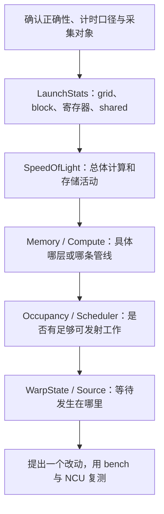
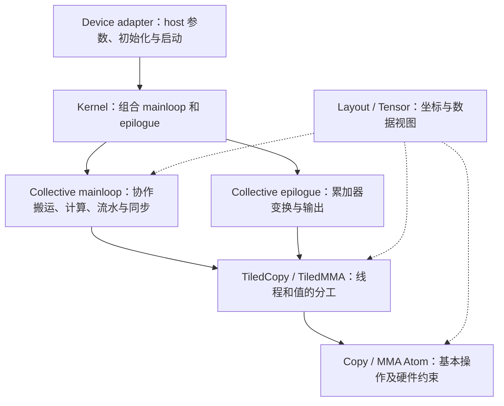

# 从手写 GEMM 到 NCU 分析与 CUTLASS CuTe

这是一份结合本项目的四天学习路线，每天约 4～5 小时，也提供三天压缩版。起点是你已经写过的合并访存、shared/register tiling、warp tiling、double buffer 和混合异步流水线；目标是独立解释一份性能报告，并读懂 CuTe GEMM 的坐标、线程分工和流水线组织。

四天的验收标准是：能完成一份有证据的性能分析、手算并验证几个 CuTe layout、沿着官方 SGEMM 示例解释数据流。完整掌握 CUTLASS、实现高性能 Tensor Core 算子，是后续阶段。

整理日期：2026-10-30。本项目环境为 RTX 4060 Laptop / Ada SM 8.9、Windows、CUDA 13.2；本机 NCU CLI 查询为 2026.1.1.0。本文提供学习命令和练习，没有重新采集性能数据。引用的成绩和计数来自已归档实验，不能当作当前源码的新测量。

前置知识查 [GPU 架构讲解](GPU_ARCHITECTURE_GUIDE.md)，容量查 [GPU_DEVICE.md](GPU_DEVICE.md)，实验入口查 [README](README.md) 与 [精选结果](results/published/README.md)。

阅读导航：[第一天 NCU 流程](#day1) → [第二天项目案例](#day2) → [第三天 CuTe 布局](#day3) → [第四天 CUTLASS](#day4)。需要动手时查看 [Layout 小程序](#layout-program)，查文档时查看 [资料索引](#references)。

## 1 四天如何安排

| 时间 | 主问题 | 学习与动手 | 当天交付物 |
|---|---|---|---|
| 第一天 | 如何从 NCU 判断下一步该查哪里 | 1 小时读采集方法；1 小时读主要 section；2 小时对比 P1 的 coalesced/shared；半小时整理 | 一张指标表和两个待验证假设 |
| 第二天 | 如何把指标变成对源码的解释 | 1 小时向量化案例；1 小时 swizzle 反例；1 小时流水线/SASS；1～2 小时复核一个案例 | 一页“现象—证据—解释—实验”报告 |
| 第三天 | CuTe 如何表达我们手写的索引 | 1 小时 Layout/Stride；1 小时 Tensor 与分块；1 小时线程/值映射；1～2 小时手算或小程序 | A/B/C 的布局表，以及 lane 到元素的映射表 |
| 第四天 | CUTLASS 如何把这些零件组织成 GEMM | 2 小时官方 CuTe SGEMM；1 小时 Copy/MMA 抽象；1 小时 CUTLASS 分层；半小时复述 | 一张项目到 CUTLASS 的对应图和一次口头讲解 |

**三天版：** 第一天完成 NCU 最小流程，并只选第二天的向量化和负优化案例；第二天完成 CuTe 布局练习；第三天读 SGEMM 示例和 CUTLASS 分层。完整流水线 SASS 追踪、Python 报告导出和 Tensor Core 阅读作为选做。

这份路线不要求再跑一遍所有 autotune，也不要求立即把现有 kernel 重写成 CUTLASS。每个实验只保留需要解释问题的形状和对照。

## 2 先把岗位术语变成可验证的能力

没有具体 JD 时，不把某家公司对“熟悉”的要求当作统一标准。对这个项目，可以用下面的任务证明你理解相关内容。

| 术语 | 本项目中可展示的能力 |
|---|---|
| NCU 指标分析 | 说明采集对象、指标单位和分母；定位到具体访存/计算指令；用对照实验检验假设 |
| CUDA 性能优化 | 解释一次优化改变了哪些请求、指令、依赖和资源，并说明为何某些 shape 会退化 |
| CUTLASS | 找到 host 参数、kernel、mainloop、epilogue 的职责，选择符合架构和精度要求的实现 |
| CuTe | 从 Shape/Stride 推导地址，解释 tile 与 thread/value partition，检查数据覆盖和指令约束 |
| Autotuning | 定义合法候选、正确性筛选、计时方法和适用 shape；说明有限搜索不是全局最优证明 |

“能列出 long scoreboard、occupancy、bank conflict”只是词汇；“能说明哪个证据支持哪个判断，以及还缺哪个实验”才是分析能力。

<a id="day1"></a>

## 3 第一天 建立 NCU 的分析顺序

### 3.1 先分清三个工具回答的问题

| 工具 | 本次用途 | 不能直接替代什么 |
|---|---|---|
| 项目 `--mode bench` | 正确性检查后，用 CUDA Event 比较自写 kernel 与同轮严格 FP32 cuBLAS | 不解释具体 pipeline 的瓶颈 |
| Nsight Compute | 深入单个 kernel 的资源、指令、访存和调度 | 采集时的 Duration 不自动等于普通 bench 时间 |
| Nsight Systems | 观察应用时间线、launch 间隙、CPU/GPU 活动与多 kernel 关系 | 不提供同等细粒度的 bank/指令分析 |

本项目已经知道热点是 GEMM，因此从 NCU 入手。以后分析完整推理程序，先用时间线确定热点，再深入 NCU 更合适。[NVIDIA Compute Triage](https://docs.nvidia.com/nsight-compute/ComputeTriage/)

### 3.2 最小操作流程

以下命令在仓库根目录、已配置 MSVC/CUDA 的终端执行。每条独立一行；在本项目常用的 x64 Native Tools Command Prompt 中可直接使用。

```bat
cmake --build build --target gemm
build\gemm.exe --mode check --kernel coalesced --m 2048 --n 2048 --k 2048
build\gemm.exe --mode check --kernel shared --m 2048 --n 2048 --k 2048
build\gemm.exe --mode bench --kernel coalesced --m 2048 --n 2048 --k 2048 --warmup 100 --iters 100 --rounds 5 --csv results\study-d1-coalesced.csv
build\gemm.exe --mode bench --kernel shared --m 2048 --n 2048 --k 2048 --warmup 100 --iters 100 --rounds 5 --csv results\study-d1-shared.csv
```

再采集指定 kernel：

```bat
ncu --set full --import-source on --launch-skip 20 --launch-count 1 --export results\study-d1-coalesced build\gemm.exe --mode profile --kernel coalesced --m 2048 --n 2048 --k 2048 --warmup 20 --iters 1
ncu --set full --import-source on --launch-skip 20 --launch-count 1 --export results\study-d1-shared build\gemm.exe --mode profile --kernel shared --m 2048 --n 2048 --k 2048 --warmup 20 --iters 1
```

项目 `profile` 不执行正确性检查，也不顺便测另一实现。当前这些自写实现每次操作启动一个 kernel，因此跳过 20 次与程序预热 20 次对应。库调用或将来的多 kernel 算法未必满足这一条件；采集 cuBLAS 时需要检查实际捕获的 kernel 名称和 launch 序列。

`full` 适合本练习一次性查看 Source 和各项统计，代价是可能多次 replay。日常只验证一个假设时，减少 section。下面是资源/调度调查的示例：

```bat
ncu --section LaunchStats --section Occupancy --section SchedulerStats --section WarpStateStats --launch-skip 20 --launch-count 1 --export results\study-scheduler build\gemm.exe --mode profile --kernel doublebuffer --m 2048 --n 2048 --k 2048 --warmup 20 --iters 1
```

NCU 的 replay、缓存清理和频率控制可能改变运行条件，程序的 warmup 不保证每次 replay 都维持热缓存。对照时保留相同设置并检查实际频率；普通 bench 用于判断收益，NCU 用于解释机制。画同一个实测 Roofline 点时，也要避免未经说明把普通 bench 的时间与另一种缓存条件下的 NCU 流量拼在一起。[NCU 采集与重放说明](https://docs.nvidia.com/nsight-compute/ProfilingGuide/index.html)

版本与字段查询，以及离线导出：

```bat
ncu --version
ncu --list-sections
ncu --query-metrics
ncu --import results\study-d1-shared.ncu-rep --page raw --csv > results\study-d1-shared-raw.csv
```

同名输出已存在时换一个文件名。当前 CMake 已包含 `-lineinfo`；不要用关闭优化的 `-G` 构建研究性能。上述 section ID 已对照本机安装文件；不同版本以实际列表为准。[NCU CLI](https://docs.nvidia.com/nsight-compute/NsightComputeCli/index.html)

本机此前遇到中文用户名下的 NCU GUI 启动异常，可按已验证方式在纯英文用户名账户打开报告。若遇到原来的 section/config 路径问题，可在 `ncu` 后添加本机选项：

```text
--config-file off --section-folder "C:\Program Files\NVIDIA Corporation\Nsight Compute 2026.1.1\sections"
```

这只是本机路径，不是 clone 后统一必需的配置；无需为了这份练习修改账户或系统设置。

### 3.3 打开报告后按什么顺序看

在 GUI 用 File → Open 打开 `.ncu-rep`。先确认上方的 kernel、grid/block、设备和频率。打开第二份报告后，可把一个结果加入 Baseline 作差值对照；比较前确认 shape、精度、参数、采集设置和构建信息。[NCU 报告界面](https://docs.nvidia.com/nsight-compute/NsightCompute/index.html)

建议顺序：



这不是必须逐页打卡的清单。先形成可检验的判断，再去看能区分不同原因的指标。

### 3.4 第一批需要掌握的指标

| 页面或指标 | 回答的问题 | 最容易误读的地方 |
|---|---|---|
| Launch Statistics 的 grid/block | 有多少工作，如何分块 | 线程多不等于有效输出多；总 block 少可能覆盖不了全卡 |
| Registers Per Thread、Shared Memory Per Block | 单 block 消耗多少资源 | 要区分声明/使用/实际分配；寄存器更多未必跨过 occupancy 台阶 |
| Theoretical Occupancy | 资源约束最多允许驻留多少 warp | 是驻留上限，不是 ALU 利用率 |
| Achieved Occupancy | 运行期间平均驻留情况 | 分母和采样口径要看清，不能代替全卡负载分布 |
| Active / Eligible / Issued Warps | 驻留 warp 中，有多少就绪、多少实际获发射 | 一个 warp 等待时，别的 warp 可能仍正常发射 |
| SM / Memory Throughput | 计算与存储子系统活动的概览 | 综合百分比不等于 `有效 GFLOP/s / FP32 峰值`，还需展开具体 pipe |
| Global sectors、requests、有效访问宽度 | 一个请求要求服务多少数据块 | 16 个 sector 可能是充分合并的 float4，也可能是标量跨距访问 |
| Shared actual / ideal / excessive wavefront | 指令需要的服务工作是否超过理想值 | 宽指令本来就可能需要多个 ideal wavefront |
| L1/L2 命中与 DRAM bytes | 请求最终走到了哪里 | global load 字节、L1/L2 sector 和 DRAM 字节不是同一个数 |
| Source 指令与谓词活跃线程 | 源码最终生成什么、多少 lane 真正参与 | 静态 SASS 行数与动态执行次数不同 |

这些页面的定义也可在本机 NCU `sections` 中查看，尤其是 `LaunchStatistics.section`、`Occupancy.section`、`SchedulerStatistics.section`、`MemoryWorkloadAnalysis.section`、`SourceCounters.section`。先理解界面标签，再按需记 raw metric。

常用 raw metric 的例子：

```text
gpu__time_duration.sum
launch__registers_per_thread
sm__warps_active.avg.pct_of_peak_sustained_active
smsp__warps_eligible.avg.per_cycle_active
smsp__issue_active.avg.per_cycle_active
sm__throughput.avg.pct_of_peak_sustained_elapsed
lts__t_sector_hit_rate.pct
```

读名称时，`sm` 与 `smsp` 的聚合范围不同；`sum` 与 `avg` 不同；`per_cycle_active` 与 `per_cycle_elapsed` 的分母不同。先核对单位，例如时间是否为 ns，再做换算。

### 3.5 Stall 应该怎样解释

先问 Scheduler 是否经常没有可发射工作，再研究 stall。不要把各 warp 的等待周期相加，当作 kernel 的墙钟耗时。

| 类型 | 初步含义 | 在 GEMM 中继续查什么 |
|---|---|---|
| Long Scoreboard | 等待 L1TEX 路径相关操作的结果依赖，包括 global/local 等 | 哪个 producer load；命中层次、合并访问、spill、独立计算窗口 |
| Short Scoreboard | 等待 MIO 等非 L1TEX 操作的结果依赖，shared 是常见来源 | LDS 对应的 actual/ideal wavefront、地址布局、其他 MIO 指令 |
| MIO Throttle | MIO 指令队列压力 | shared 指令是否太密；向量化和复用能否减少发射工作 |
| LG Throttle | local/global 指令队列压力 | 指令数量、宽度、local 访问和请求分布 |
| Barrier | warp 在等参与同步的其他线程/warp | barrier 次数、各 warp 工作量是否均衡、能否安全改变流水组织 |
| Math Pipe Throttle | 所需计算管线暂不能接收更多工作 | 哪条 pipe 繁忙；是否已经接近该管线限制 |
| Wait | 固定延迟执行依赖 | 独立累加器数量、计算依赖链；不是 global 延迟的别名 |
| Not Selected | 已就绪，但本次调度选了别的 warp | 可能说明有足够可选工作，不应一律当作坏事 |

Source 的 stall 样本通常定位到等待结果的消费指令。比如 FFMA 行有 scoreboard 等待，应该追踪它依赖的 LDS/LDG，不能立即认定 FFMA 算术单元慢。字段的完整定义见 [NCU Warp Stall Reasons](https://docs.nvidia.com/nsight-compute/ProfilingGuide/index.html#warp-stall-reasons)。

### 3.6 当天练习和验收

对 P1 的 coalesced 与 shared，填下表，不预设一定是 DRAM 带宽瓶颈：

| 项目 | coalesced | shared |
|---|---|---|
| 普通 bench median_ms / GFLOP/s | 待填 | 待填 |
| 本次配对 cuBLAS / self 时间比 | 待填 | 待填 |
| block、grid、register/thread、shared/block | 待填 | 待填 |
| 理论与实际 occupancy | 待填 | 待填 |
| global 请求/sector；L2 命中；DRAM bytes | 待填 | 待填 |
| shared actual/ideal wavefront | 不适用或按实际指令 | 待填 |
| eligible warp、issue 活动、主要等待 | 待填 | 待填 |

验收问题：shared 减少重复 global 访问后，增加了哪些工作？当前 P1 的 A+B 约为 32 MiB，与本机 L2 容量相近，这为什么会影响“global 读取次数就是 DRAM 读取次数”的判断？

<a id="day2"></a>

## 4 第二天 用项目的反例训练分析能力

### 4.1 向量化案例 字节没少但指令少了

先读 [register 向量化实验](results/published/register/vector-load/README.md) 和其中的 `profile-summary.json`、`profile-source-evidence.json`。这组历史对照保留了只改变搬运方式的 diff。

P1 的观察包括：LDG/STS 动态指令均减少 75%，global load 总 sector 不变，shared store 的总 ideal wavefront 不变，FFMA 和计算 LDS 数量不变。总动态 warp 指令下降约 16.395%。

练习按下面顺序写解释：

1. 明确是一条线程访问宽度从一个 float 变成四个 float，处理的数据总量没少。
2. 查看 SASS 中 `LDG.128`、`STS.128` 是否出现，确认编译结果。
3. 分别比较指令数、sector 数和 wavefront 数；不能把它们混为“内存访问次数”。
4. 查索引/循环指令是否随之减少，再用同轮 bench 检查收益和波动。

这比“float4 一定快四倍”更接近可审计的结论。该历史报告的 P1 初测与补测有漂移，报告保留了两者；学习时不要只抄最快一轮。

### 4.2 冲突消除了 为什么还可能更慢

读 [doublebuffer_opt 分析](results/published/asyncpipeline-20261023/README.md) 与 [NCU 摘要](results/published/asyncpipeline-20261023/ncu-summary.json)。其中保留的 P1 结构证据如下：

| 指标 | doublebuffer | doublebuffer_opt |
|---|---:|---:|
| A 标量 STS actual / ideal wavefront | 16,777,216 / 4,194,304 | 4,194,304 / 4,194,304 |
| C 动态 warp store 指令 | 131,072 | 32,768 |
| 全部动态 warp 指令 | 367,136,768 | 411,312,128 |
| 寄存器/thread | 105 | 119 |
| 理论 occupancy | 33.33% | 33.33% |

应该得到的结论是：冲突和 C 写回请求确实改善，但布局/寻址等指令增加；两版寄存器数虽不同，报告中的理论 occupancy 没有下降。不能用“寄存器多了”直接推断“驻留少了”。

还应主动指出证据缺口：这组历史对照没有保留可审计的普通 benchmark CSV，两份 NCU 的频率也不同，因此不能拿它们的 Duration 给出优化的净收益百分比。当前数据支持机制解释，未隔离每项变化的因果贡献。

若继续实验，应分别测试“只改 swizzle”和“只改 C 写回”，保持 tile、编译、shape 和计时条件一致。优化一个局部指标的价值取决于它是否处在当前关键路径上。

### 4.3 软件预取与硬件异步 怎样查 SASS

先读 [doublebuffer 的 SASS 审计](results/published/doublebuffer-20261022/README.md)，再看 [asyncpipeline 对照](results/published/asyncpipeline-20261023/README.md)。给一段主循环做以下标注：

```text
下一批的读取指令及目的寄存器 / shared stage
    ↓
当前批计算是否独立于下一批的返回值
    ↓
下一批第一次被消费或等待的位置
    ↓
哪个同步保证跨线程可见性、哪个同步保护缓冲区重用
```

当前项目中，doublebuffer 是普通 LDG 到寄存器后再 STS；hybrid asyncpipeline 的 A 仍走这条转置路径，B 则使用 LDGSTS。该历史对照中，hybrid 的总动态 warp 指令多约 7.39%，寄存器/thread 从 105 降到 79，FFMA 数量相同。

练习必须分开回答三个问题：机器码是否使用异步拷贝；是否存在可重叠的依赖窗口；实际隐藏了多少延迟。前两个可从指令与依赖得到证据，第三个不能仅凭静态 SASS 得出，需要性能与调度证据。`DEPBAR` 的出现本身也不是“已经完全重叠”的证明。

### 4.4 小矩阵 为什么不能照搬 P1 的判断

用 [固定矩阵](benchmarks/matrix.csv) 中的 P4：`M=16,N=256,K=128`。若 `BM=BN=64`：

```text
grid blocks = ceil(16/64) × ceil(256/64) = 4
本机 SM 数 = 24
```

四个普通 CTA 无法同时铺满 24 个 SM。输出 tile 的有效行只有四分之一，尾部谓词还可能造成算术浪费。这里需要区别全卡工作量不足、每 SM 驻留限制，以及每条指令的有效 lane 数。

P4 测量很短，launch 间隙和采样扰动也更显著。先看普通 bench 的多轮稳定性；若怀疑 launch/CPU 提交问题，再用 Nsight Systems。不要为了让 P4 的 NCU 百分比好看，直接换成 P1 并宣称解决了小矩阵问题。

### 4.5 Roofline 如何接到指标分析上

打开已有 [七版本 Roofline](results/published/roofline-20261022/README.md)，核对每个点的构建、形状和分母。

```text
有效吞吐 P = 2 × M × N × K / time
某内存层的 AI = 同一口径的 FLOPs / 该层流量
对应上界 = min(选定计算峰值, 该层带宽 × AI)
```

DRAM roofline 要用 DRAM 流量；L2/shared 的分析需要各自对应的流量和带宽。`4(MK+KN+MN)` 是一次读写的算法最低数据量估计，不自动等于本次 DRAM 实测字节。NCU 的指令级 FLOPs 与项目 `2MNK` 的有效 FLOPs，在尾部多算时也可能不同。

点在 DRAM roofline 下方，不代表唯一原因就是 DRAM：指令发射、shared 服务、数据依赖、同步和全卡工作量都可能留下差距。先看图建立假设，再回到具体指令和计数。

### 4.6 一页性能分析的填写模板

```text
对象：kernel / shape / dtype与累加精度 / tile参数 / 源码与构建指纹
结果：同轮多次 bench 时间、GFLOP/s、cuBLAS 对照、波动
采集：NCU版本、section、kernel范围、时钟/缓存/replay设置
现象：最值得解释的一个差异
证据：具体计数、单位、SASS位置或源代码范围
解释：哪类工作减少/增加，哪个依赖可能改变
其他解释：尚未排除的时钟、指令量、资源或工作量变化
下一实验：只改变一个因素，预期哪个指标怎样变化
结论边界：目前能确认什么，仍不能确认什么
```

当天只做一份。优先选择向量化，或“消除冲突未必更快”的案例。

<a id="day3"></a>

## 5 第三天 用 CuTe 表达索引与线程分工

### 5.1 CuTe 与 CUTLASS 分别负责什么

CuTe C++ 提供布局、张量视图、线程/值分工，以及 copy/MMA 等可组合抽象；它随 CUTLASS 源码提供，核心头文件在 `include/cute/`。CUTLASS 在这些零件之上提供更完整的 GEMM kernel、mainloop、epilogue 和 host 接口。

本路线先学 **CuTe C++**，与当前 `.cu`、模板和 nvcc 工作流衔接。官方现在也有 CuTe DSL/Python 路线，语法、JIT 和运行环境另成一套；不要混用两套教程的代码。[CuTe C++ 入门](https://docs.nvidia.com/cutlass/latest/media/docs/cpp/cute/00_quickstart.html)

### 5.2 Layout 是坐标到偏移的函数

普通二维布局可以写成：

```text
offset(r,c) = r × stride_r + c × stride_c
```

例如逻辑 `4×8` 的 row-major float 矩阵：

```text
Shape  = (4,8)
Stride = (8,1)
L(2,5) = 2×8 + 5 = 21
```

这里的 stride/offset 是元素单位；对 float，字节偏移是 `21×4`。shape 说明可用坐标范围，不独自决定 row-major 或 column-major。下面是对应的小片段，布局创建和打印语句放在函数体内；第 7 节提供完整程序：

```cpp
#include <cute/tensor.hpp>

using namespace cute;

auto layout = make_layout(make_shape(Int<4>{}, Int<8>{}),
                          make_stride(Int<8>{}, Int<1>{}));
auto offset = layout(make_coord(2, 5));  // 21
print_layout(layout);
```

`Int<8>{}` 把值放进类型，属于编译期信息；普通整数 `8` 可以作为运行时值。两者都能表示布局，但能否在编译期完成推导、匹配特化和消除索引运算可能不同。CuTe 不是“所有尺寸必须编译期固定”的规则。[Layout 定义与构造](https://docs.nvidia.com/cutlass/latest/media/docs/cpp/cute/01_layout.html)

### 5.3 用现有 GEMM 表达 A B C

项目的物理输入是 A[M,K]、B[K,N]、C[M,N]，全部 row-major。直接按这些逻辑坐标表达：

| Tensor | Shape | Stride | 地址偏移 |
|---|---|---|---|
| A | `(M,K)` | `(K,1)` | `m*K+k` |
| B | `(K,N)` | `(N,1)` | `k*N+n` |
| C | `(M,N)` | `(N,1)` | `m*N+n` |

官方 CuTe GEMM 教程通常把乘法写成逻辑的 `(M,K) × (N,K) → (M,N)`。因此同一块物理 B[K,N] 数据，在该接口里应表达为：

```text
B 的逻辑 Shape  = (N,K)
B 的逻辑 Stride = (1,N)
B_view(n,k)     = b[n + k*N]
```

这只是换了一套逻辑坐标，**没有搬动或物理转置 B**。`shape=(N,K), stride=(K,1)` 则会访问另一组地址，不能互换。[CuTe GEMM 教程的张量约定](https://docs.nvidia.com/cutlass/latest/media/docs/cpp/cute/0x_gemm_tutorial.html)

同样，当前转置后的 As 物理存储是 `As[k][m]`，可用 `(BK,BM):(BM,1)` 表达。如果希望从逻辑 `(m,k)` 访问它，则用 `(BM,BK):(1,BM)`。判断是否真的转置了数据，要看 producer 写入地址与 consumer 读取地址，不能只看变量名。

### 5.4 Tensor 是访问数据的视图

对已有指针构造 Tensor 时，可以先理解成“指针/engine + layout”。视图不自动复制数据，`make_tensor` 不会把 global 数据送到 shared。

```cpp
// 片段：假设 a、M、K 已存在。
auto gA = make_tensor(make_gmem_ptr(a),
                      make_layout(make_shape(M, K), make_stride(K, Int<1>{})));
// gA(m,k) 对应 a[m*K+k]
```

CuTe 也能构造寄存器存储的 owning tensor，不能把所有 Tensor 都理解成外部指针。先阅读 [Tensor 教程](https://docs.nvidia.com/cutlass/latest/media/docs/cpp/cute/03_tensor.html) 中 engine 与 layout 的分工，再看 fragment。

布局还可能有 padding。对 `Shape=(4,8), Stride=(10,1)`：逻辑有 32 个元素，但最大访问偏移是 `3×10+7=37`，需要覆盖 38 个元素的位置范围。对这个正步长例子，`size=32`、`cosize=38`；不能把逻辑元素数当成有 padding 时的存储跨度。

### 5.5 Tiling 是坐标分解

对逻辑 `(M,K)=(128,64)`，取 `(BM,BK)=(32,16)`，可以把坐标拆成：

```text
tile_row ∈ [0,4)       local_row ∈ [0,32)
tile_k   ∈ [0,4)       local_k   ∈ [0,16)

m = tile_row*32 + local_row
k = tile_k*16 + local_k
offset = m*64 + k
```

例如 `(tile_row,tile_k,local_row,local_k)=(2,1,3,5)`，得到 `(m,k)=(67,21)`，offset 为 4309。这就是手写 `block_start_row`、`p` 和局部索引在做的事。

阅读 `logical_divide`、`zipped_divide`、`local_tile` 时，优先追踪输入和输出 mode，弄清哪个 mode 是 tile 内坐标、哪个是 tile 编号。它们的返回 shape 组织不同；不要把几种 divide 当成同一个函数。[Layout Algebra](https://docs.nvidia.com/cutlass/latest/media/docs/cpp/cute/02_layout_algebra.html)

这些操作构造视图或坐标映射，**不创建 CUDA block，不自动发起 load，也不自动同步**。

### 5.6 Thread Value Layout 为什么重要

你已经写过：

```cpp
int vector_id = tid + slot * THREADS;
int element = 4 * vector_id;
```

它表达了“线程 tid 在第 slot 轮负责哪四个元素”。去掉多轮部分，一个 warp 每线程负责四个相邻值，可以写成：

```text
element(tid,value) = 4*tid + value
tid ∈ [0,32), value ∈ [0,4)
```

把它视作 `(32,4):(4,1)` 的简单 Layout：

| 线程 | value=0 | value=1 | value=2 | value=3 |
|---|---:|---:|---:|---:|
| 0 | 0 | 1 | 2 | 3 |
| 1 | 4 | 5 | 6 | 7 |
| 7 | 28 | 29 | 30 | 31 |
| 8 | 32 | 33 | 34 | 35 |

这张表还没规定用四条标量指令，还是一条 128-bit 指令。如果是标量 shared load，固定 value=0 时，lane 0 和 8 读不同字但同 bank；如果是满足条件的连续宽访问，应该按实际指令的 ideal/actual wavefront 重新分析。

也可以定义 `element(tid,value)=tid+32*value`：它让每轮标量访问沿 lane 连续，但每个线程自己的四个值不连续。两者覆盖的数据相同，合适的指令与分工不同。CuTe 的价值之一就是把这些映射显式组合，而不是把它们藏在多个除法/取模里。

计算分工与搬运分工也不必相同：某线程可以搬入一段连续 A，但最终计算另一组输出；中间靠正确的 shared 布局和同步连接。

### 5.7 当天练习与自检答案

先手算，再用 `print_layout` 或小程序核对：

1. `(4,8):(8,1)` 的 `(2,5)` 偏移是多少？答案 21。
2. `(4,8):(1,4)` 的 `(2,5)` 偏移是多少？答案 22，布局变成按第一维连续。
3. B 物理为 `K=5,N=8`，访问逻辑 `B_view(n=3,k=2)`。答案 `3+2*8=19`。
4. `As[k][m]`、`BK=16,BM=64`，访问逻辑 `(m=7,k=3)`。答案 `3*64+7=199`。
5. 对 `4*tid+value` 与 `tid+32*value`，分别画固定 value 时的 32 个地址；说明适合的搬运指令。
6. 把项目默认 warp 参数代入：`WMITER=2`，每线程累加器形状为 `8×4`，不是 `4×4`；列出两个 M 子块如何由 `wm*WSUBM` 拼起来。

选做：为一种固定的 scalar shared 指令枚举所有 lane 的地址和 bank，再添加 padding/swizzle，检查同 bank 的不同 word 是否减少。换成 LDS.128 后要重做分析。CuTe 的 `Swizzle` 是位映射构件，不是自动寻找全局最优布局的工具。

<a id="day4"></a>

## 6 第四天 沿着一个 GEMM 读 CUTLASS

### 6.1 固定阅读版本 从 FP32 SIMT 开始

源码阅读选 [CUTLASS v3.9.2](https://github.com/NVIDIA/cutlass/releases/tag/v3.9.2)，避免教程随主分支变化。这个 tag 是固定阅读材料，不表示已经验证它在本机 CUDA 13.2/MSVC 下的完整构建。在线 `latest` 文档可用于查概念；具体函数签名和实现以选定 tag 为准。

顺序读这两份：

1. [sgemm_1.cu](https://github.com/NVIDIA/cutlass/blob/v3.9.2/examples/cute/tutorial/sgemm_1.cu)：先找 global tensor、CTA tile、shared、线程 partition、copy、gemm、写回。
2. [sgemm_2.cu](https://github.com/NVIDIA/cutlass/blob/v3.9.2/examples/cute/tutorial/sgemm_2.cu)：继续找 TiledCopy、TiledMMA、fragment 和寄存器预取。

先标注数据的坐标和存储位置，不要从模板错误信息或所有 traits 的定义开始逐层展开。

### 6.2 读源码时逐个回答这七个问题

| 问题 | 在源码中寻找 | 对应本项目 |
|---|---|---|
| 全矩阵怎么寻址 | `make_tensor`、shape、stride | A/B/C 指针与行宽 |
| CTA 拿到哪块 | `local_tile`、block 坐标、K tile mode | BM/BN/BK 和 block 起点 |
| shared 如何存 | shared 数组和 layout | As 转置、Bs 行布局、padding |
| 线程搬哪些数据 | `local_partition` 或 Copy 的 `get_slice`、`partition_S/D` | `tid + slot*THREADS` |
| 线程计算哪些数据 | MMA 的 `partition_A/B/C`、fragment | atmp/btmp、threadResults |
| 各批何时可用 | K 循环、copy、wait、barrier | prefetch、publish、compute |
| 结果怎样输出 | epilogue、copy、axpby 等写回 | C 索引、alpha/beta、合并 store |

给每个 tensor 注释逻辑 shape 与存储空间。在这两份官方示例中，`mA` 是整个 global view，`gA` 是当前 CTA 的 global tile 视图，通常还保留 K tile mode；`sA` 是 shared view，`tArA` 是某个线程持有的 A 寄存器片段。名字只是线索，最终要看定义和 partition 结果。

### 6.3 Copy Atom TiledCopy MMA Atom TiledMMA

| 抽象 | 表达的内容 | 本项目中的直觉 |
|---|---|---|
| Copy Atom | 基础 copy 操作及类型、宽度、参与线程等约束 | 普通标量、宽 copy 或架构专用异步 copy |
| TiledCopy | 把 copy atom 铺到线程和值，组织源/目标分工 | 合作加载的循环与每线程 float4 |
| MMA Atom | 基础乘加操作与操作数/线程布局约束 | 普通 FMA 或某种 Tensor Core 指令 |
| TiledMMA | 组合 atom，描述计算 tile 与各线程 fragment | warp/thread tiling 的计算分工 |

`get_slice(tid)` 取出这个线程的职责；`partition_S/D` 得到源/目的的线程视图；实际数据移动发生在后续 copy 操作。MMA 的 partition 描述计算操作数与结果分工，不等于 global 搬运的分工。[CuTe MMA Atom](https://docs.nvidia.com/cutlass/latest/media/docs/cpp/cute/0t_mma_atom.html)

**MMA 这个名称不保证使用 Tensor Core。** 固定版本 `sgemm_2` 使用 `UniversalFMA`，很适合与当前 FP32 FFMA kernel 对照。以后选择 Tensor Core atom 时，才能进一步讨论受指令约束的 fragment 布局和精度。

编译期布局可以消除大量手写索引组织的复杂度，但不能承诺最终指令更少。实际生成标量还是宽访存、寻址是否复杂、寄存器是否溢出，仍要看 SASS/NCU。

### 6.4 教程的流水线 与我们的实现哪里相同

固定 v3.9.2 的 `sgemm_2` 是普通 copy 到寄存器的预取：

```text
预先取 tile 0 到寄存器

循环：
    等待所有线程不再读取上一批 shared
    将寄存器中的当前 tile 写到 shared
    等待所有线程完成写入
    将下一 tile 预取到寄存器
    计算当前 shared tile
```

它使用一份 shared tile，寄存器预取提供跨迭代安排。不要把它称为 `cp.async` 双 shared buffer。我们的 doublebuffer 增加第二份 shared，还可以让一处切换 barrier 同时保护旧 tile 读取和新 tile 发布；这是额外的组织差别。

`sgemm_1` 的通用 copy 后有 `cp_async_fence()` / `cp_async_wait<0>()`，随后 block 同步。仅看到这些辅助调用，不能判断具体 copy 最终用了什么指令，更不能判断计算与搬运已重叠。需要检查 copy 类型与生成的机器码。

当天练习：在两份官方源码各画一条“存储位置变化 + 同步”的时间线，再对照 [项目双缓冲说明](results/published/doublebuffer-20261022/README.md)。

### 6.5 CUTLASS 的层次 怎样对应我们项目

下面是 CUTLASS 3.x GEMM API 的职责划分；每层是软件抽象，不是一块额外的 GPU 硬件：



| 本项目 | CUTLASS 中应找的职责 |
|---|---|
| CLI、分配、cuBLAS 对照 | 应用层/harness，不由 CuTe 自动完成 |
| `launch_*` 和模板参数检查 | host adapter、arguments、`can_implement` 等适用性检查 |
| `sgemm_*` 核函数 | kernel 层 |
| K tile 循环、stage、wait、barrier | collective mainloop / dispatch policy |
| TM/TN、warp 子块、atmp/btmp | tiled MMA 与 fragment 布局 |
| cooperative load、float4 | tiled copy 与 copy atom |
| C 写回、缩放、融合操作 | epilogue |

常见入口名包括 `cutlass::gemm::device::GemmUniversalAdapter`、`cutlass::gemm::kernel::GemmUniversal`、`cutlass::gemm::collective::CollectiveMma`；epilogue 有相应的 `cutlass::epilogue::collective` 组织。这里只先建立职责图，不要求今天实现整套模板参数。[CUTLASS 3.x GEMM API](https://docs.nvidia.com/cutlass/latest/media/docs/cpp/gemm_api_3x.html)

### 6.6 不要把 API 家族 软件版本和硬件代际混在一起

网上的 CUTLASS 2.x 风格常见 `cutlass::gemm::device::Gemm` 和 threadblock/warp/thread 层次；3.x 风格更明确地拆出 collective、kernel 和 adapter。新的库版本仍可能支持旧 API，因此不是“装了 3.x 就不能使用 2.x 风格”。[API 兼容说明](https://docs.nvidia.com/cutlass/latest/media/docs/cpp/cutlass_3x_backwards_compatibility.html)

| 主题 | 这四天的安排 |
|---|---|
| CuTe C++ Layout/Tensor、FP32 SIMT 示例 | 主线 |
| SM80 家族的 cp.async 路径 | 对照本项目理解；确认实例和 SM89 支持 |
| Tensor Core warp MMA | 认识 operand/accumulator 精度与 fragment，作为下一阶段 |
| Hopper 的 TMA、WGMMA、cluster | 架构边界阅读，不拿来当本机可运行实践 |
| Blackwell 专用指令与调度 | 暂缓 |
| CuTe DSL/Python | 后续根据具体岗位和开发环境单独学习 |

即使本机有 Tensor Core，也不能把 FP16/TF32 输入路径的吞吐直接标成当前严格 FP32 SGEMM 的同契约提升。比较时记录输入精度、乘法方式、累加精度、误差阈值和 SASS 指令类型。

### 6.7 当天验收

用自己的话连续讲清楚：

1. CuTe 的 Layout 与 global/shared/register 各自是什么，为什么改变视图不等于搬数据。
2. B 的逻辑 `(N,K)` 如何访问物理 row-major `(K,N)`。
3. 为什么 copy 的线程分工可以与 MMA 的计算分工不同。
4. `sgemm_2` 的寄存器预取，与我们的双 shared buffer 有什么区别。
5. CUTLASS 哪一层负责 K 主循环，哪一层负责结果写回。
6. 如果换成 CuTe 后变慢，你会按什么顺序检查正确性、布局、指令、资源和计时。

选做实践：只把现有一个 kernel 的地址计算表达成 CuTe view，保持 tile、线程数、精度和算法不变。先检查 P3 尾部，再比较 SASS 与 bench。这个实验的目标是学习抽象与生成代码的关系，不预设会提速。

<a id="layout-program"></a>

## 7 一个可独立练习的 CuTe Layout 小程序

可以先只在纸上做第三天。如果要实际编译，不必构建整个 CUTLASS。下面使用固定源码版本，放在项目外的学习目录；这是给你执行的准备步骤，本次未下载依赖或验证编译。

```bat
git clone --branch v3.9.2 --depth 1 https://github.com/NVIDIA/cutlass.git D:\cutlass-study
```

在项目的 `build/cute_layout_study.cu` 保存以下完整程序。它只做 host 上的布局运算，不启动 GEMM：

```cpp
#include <cute/tensor.hpp>
#include <cstdio>

int main() {
    using namespace cute;
    auto row = make_layout(make_shape(Int<4>{}, Int<8>{}),
                           make_stride(Int<8>{}, Int<1>{}));
    auto padded = make_layout(make_shape(Int<4>{}, Int<8>{}),
                              make_stride(Int<10>{}, Int<1>{}));
    auto b_nk = make_layout(make_shape(Int<8>{}, Int<5>{}),
                            make_stride(Int<1>{}, Int<8>{}));

    std::printf("row(2,5)=%d\n", int(row(make_coord(2, 5))));
    std::printf("padded size=%d cosize=%d\n", int(size(padded)), int(cosize(padded)));
    std::printf("B(n=3,k=2)=%d\n", int(b_nk(make_coord(3, 2))));
    print_layout(row);
    return 0;
}
```

在 MSVC x64 开发终端、项目根目录执行：

```bat
nvcc -std=c++17 --expt-relaxed-constexpr -arch=sm_89 -I D:\cutlass-study\include build\cute_layout_study.cu -o build\cute_layout_study.exe
build\cute_layout_study.exe
```

预期前三行是 `row(2,5)=21`、`padded size=32 cosize=38`、`B(n=3,k=2)=19`，随后是布局表。若遇到工具链兼容问题，先核对版本和第一条编译错误；不要为编一个布局练习就重配整个 GEMM 工程。Windows 构建要求见 [官方 Windows 指南](https://docs.nvidia.com/cutlass/latest/media/docs/cpp/build/building_in_windows_with_visual_studio.html)。

## 8 最后需要避免的误判

| 表面结论 | 应该补充的判断 |
|---|---|
| Occupancy 越高越好 | 更高驻留是否带来更多有效 issue，是否牺牲了复用与 ILP |
| Long scoreboard 高就是 DRAM 带宽满 | 先区分依赖延迟、命中层次、访存分布和可发射工作 |
| Shared 4 个 wavefront 就是 4-way 冲突 | 看 actual 与 ideal，结合指令宽度、重复地址与活跃 lane |
| 命中率高说明内存已经不是问题 | 缓存也有吞吐、队列和延迟限制，访存指令仍要发射 |
| 只有源码行占比最高的地方值得改 | 先确认列是采样、动态计数还是其他指标；一行可能映射多条指令 |
| `coalesce(layout)` 保证合并访存 | 它是布局代数的化简；global 合并访问仍由同条指令的 lane 地址决定 |
| `copy` 就会用 128-bit 或 cp.async | 还依赖所选 atom、类型、布局、对齐、边界与生成代码 |
| 用 CUTLASS/CuTe 就不需要看 SASS | 抽象表达意图，SASS/NCU 验证实际实现 |
| 一次 autotune 的冠军是通用最优 | 配置依赖 shape、GPU、精度、测量条件和候选集 |

<a id="references"></a>

## 9 按问题查阅的资料

一天先读对应章节，链接作为查阅入口，不要求通读全部手册。

| 顺序 | 资料 | 重点 |
|---|---|---|
| 1 | [项目 GPU 架构讲解](GPU_ARCHITECTURE_GUIDE.md) 第 6、8、11、12 部分 | bank、调度、流水与指标的共同基础 |
| 2 | [NCU CLI](https://docs.nvidia.com/nsight-compute/NsightComputeCli/index.html) | section、kernel 过滤、导出/导入、采集范围 |
| 3 | [NCU Profiling Guide](https://docs.nvidia.com/nsight-compute/ProfilingGuide/index.html) | replay、clock/cache control、指标结构、memory tables |
| 4 | [Compute Triage](https://docs.nvidia.com/nsight-compute/ComputeTriage/) | 怎样按证据逐步缩小瓶颈范围 |
| 5 | [NCU Python Report Interface](https://docs.nvidia.com/nsight-compute/PythonReportInterface/index.html) | 选做：读取 ncu-rep 的 range/action/metric，批量整理对照 |
| 6 | [CuTe Quickstart](https://docs.nvidia.com/cutlass/latest/media/docs/cpp/cute/00_quickstart.html) 与 [Layout](https://docs.nvidia.com/cutlass/latest/media/docs/cpp/cute/01_layout.html) | 打印布局、静态值、坐标到偏移 |
| 7 | [Layout Algebra](https://docs.nvidia.com/cutlass/latest/media/docs/cpp/cute/02_layout_algebra.html) 与 [Tensor](https://docs.nvidia.com/cutlass/latest/media/docs/cpp/cute/03_tensor.html) | divide/composition、view、partition |
| 8 | [CuTe GEMM 教程](https://docs.nvidia.com/cutlass/latest/media/docs/cpp/cute/0x_gemm_tutorial.html) | 按数据流串起前面的概念 |
| 9 | [CUTLASS Efficient GEMM](https://docs.nvidia.com/cutlass/latest/media/docs/cpp/efficient_gemm.html) | tiling、软件流水、epilogue、并行工作量 |
| 10 | [CUTLASS 3.x API](https://docs.nvidia.com/cutlass/latest/media/docs/cpp/gemm_api_3x.html) | device/kernel/collective/tiled/atom 的分工 |

四天后保留三份成果即可：一页 NCU 分析、一份布局手算/小程序、一张 CuTe GEMM 到当前源码的对应图。后续选择一个小改动，把“抽象如何表达”与“机器码实际做了什么”再次连接起来。
