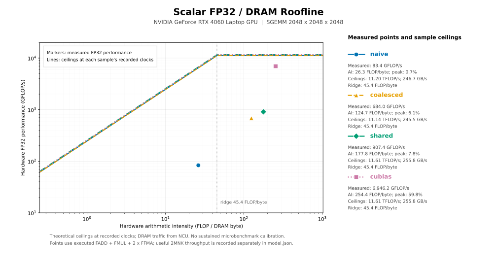

# Naive → coalesced → shared：同轮基线

测量于 2026-10-18，RTX 4060 Laptop GPU（SM 8.9），Release；原始本地目录为 `results/kernel-comparison-20261018`。本目录保留该轮完整 P1/P2/P3 计时，而不重复收录 2026-10-17 的 naive 单独实验。

| 实现 | P1：2048×2048×2048 | P2：16×4096×4096 | P3：1001×769×513 |
|---|---:|---:|---:|
| naive | 117.10 | 101.19 | 380.19 |
| coalesced | 959.37 | 653.05 | 903.82 |
| shared | 1209.10 | 485.29 | 1048.91 |

单位为 GFLOP/s。数值来自 [comparison.json](comparison.json)；[comparison.csv](comparison.csv) 还列出每个实现**同次配对的 cuBLAS**。P1 的 coalesced/naive 为 8.19×，shared/coalesced 为 1.26×；P2 的 shared 则比 coalesced 慢。这是优化依赖矩阵形状的早期证据。

三组实现使用同一份源码快照、seed=42、warmup=20、rounds=5，P1/P2/P3 的 iters 为 44/335/800。每轮交替测目标实现与严格 FP32 cuBLAS（`CUBLAS_COMPUTE_32F_PEDANTIC`），Event 区间不含分配、拷贝和检查。不同配对实验中的 cuBLAS 值有波动；不能拿另一天的 cuBLAS 当统一分母。每个 CSV 的 `round_mean_ms` 保存五轮单次平均耗时；`median_ms` 为其中位数，`GFLOP/s = 2MNK/(median_ms×10^6)`。

- [naive 原始 P1](benchmark-naive/P1.csv)、[coalesced 原始 P1](benchmark-coalesced/P1.csv)、[shared 原始 P1](benchmark-shared/P1.csv)：同目录还有 P2/P3 与 summary。
- [validation.json](validation.json)：历史检查、sanitizer 与源文件一致性证据；[capture.json](capture.json) 保存构建输入哈希。
- [info.log](info.log)：历史设备、库和数学模式。
- [source-snapshot.zip](source-snapshot.zip)：原始构建源码、测试及必要脚本，约 23 KB。
- [publication.json](publication.json)：每份复制文件的原始相对路径和 SHA256；原始本地目录不必存在。

整理时已按快照中原 CMake 的文件顺序离线重算构建指纹，与 CSV/capture 中的 `source_sha256` 一致；九组性能中位数也已从原始轮次核对。没有为归档重新编译或运行 GPU。

## Roofline 与计时口径



保留一张图及 [model.json](roofline/model.json)、[profiling-metrics.json](profiling-metrics.json)。图中使用 NCU 采集时执行的 FP32 FLOP 和 DRAM bytes；FFMA 按 2 FLOP。理论上限由对应报告的实际时钟及 NCU 峰值指标计算，未用持续算力/带宽微基准校准。这里只覆盖 scalar FP32 / DRAM，不含 Tensor Core、L1/L2 上限。

NCU 使用 kernel replay、cache-control=all、clock-control=boost，跳过 20 次 warmup 后采一次 P1。其时间、缓存和时钟条件不同，图中的 GFLOP/s 不替代上面的普通 Event benchmark。模型中的原 `.ncu-rep` 路径仅用于历史溯源；大型二进制报告未发布，已有图表和指标可以独立阅读，无法只凭本目录重新打开原始 NCU GUI 报告。

## 从快照重测

在项目根目录、已配置 CUDA/MSVC x64 的终端中运行；其他 GPU 应修改架构参数。快照解压到独立目录，不覆盖当前 `src/`。

```bat
python -m zipfile -e results\published\baseline\source-snapshot.zip build\repro-baseline-source
cmake -S build\repro-baseline-source -B build\repro-baseline -G "NMake Makefiles" -DCMAKE_BUILD_TYPE=Release -DCMAKE_CUDA_ARCHITECTURES=89 -DBUILD_TESTING=OFF
cmake --build build\repro-baseline --target gemm
build\repro-baseline\gemm.exe --mode check --kernel shared
build\repro-baseline\gemm.exe --mode bench --kernel shared --m 2048 --n 2048 --k 2048 --warmup 20 --iters 44 --rounds 5
```

将 `shared` 换成 `naive` 或 `coalesced` 即可重测另外两版。P2/P3 的尺寸和迭代参数见 [matrix.csv](benchmark-shared/matrix.csv)。这是重现实现和测量方法；GPU、驱动、编译器、温度及系统负载改变后，不保证复现完全相同的耗时。本次整理没有重新运行 GPU。
