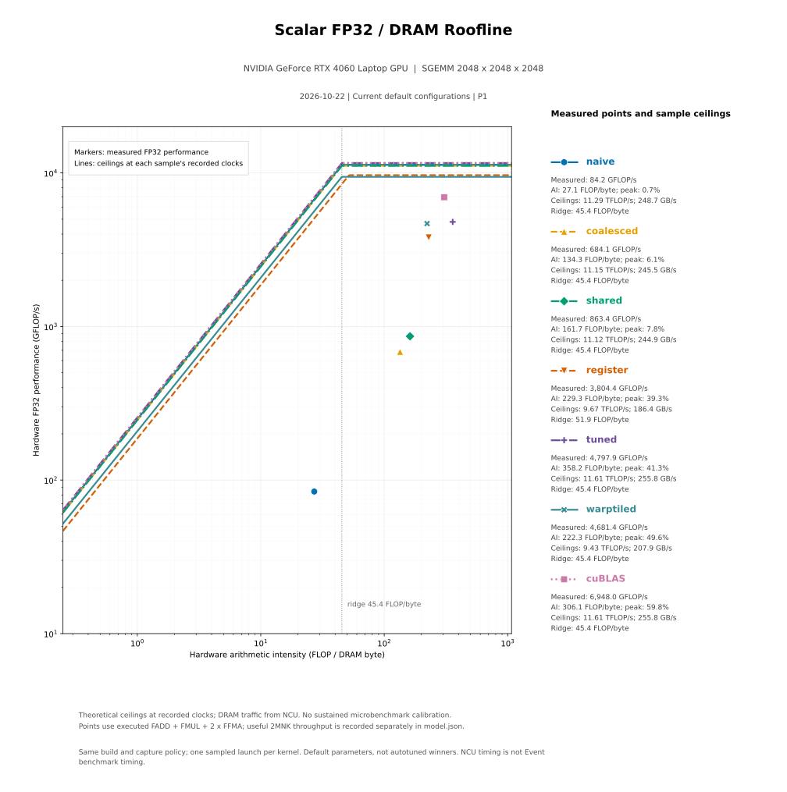

# 当前七版本 Roofline：2048 × 2048 × 2048

2026-10-22，在 RTX 4060 Laptop（SM 8.9）上重新采集当前 **naive、coalesced、shared、register、tuned、warptiled、cuBLAS**。使用同一个 Release 程序与默认参数；不是将不同日期的最优结果拼接，也没有重新进行 autotuning。



可下载 [PNG](roofline.png)，或查看 [完整模型](model.json)、[数值表](comparison.csv)、[采集命令与源码指纹](capture.json)。图采用与[之前基线](../baseline/README.md)相同的 scalar FP32 / DRAM 公式。

## 本轮数值

图中纵轴为实际执行的 `FADD + FMUL + 2×FFMA` 吞吐，横轴为这些运算与 DRAM 流量之比。有效 GEMM 吞吐另外按 `2MNK/t` 计算。下面时间全部来自 **NCU**，不能替代普通 CUDA Event benchmark。

| 实现 | NCU 时间 ms | 硬件 GFLOP/s | 有效 GEMM GFLOP/s | 硬件 AI FLOP/byte | FP32 峰值占比 | SM GHz |
|---|---:|---:|---:|---:|---:|---:|
| naive | 204.1647 | 84.16 | 84.15 | 27.12 | 0.75% | 1.838 |
| coalesced | 25.1135 | 684.09 | 684.09 | 134.35 | 6.14% | 1.814 |
| shared | 19.8980 | 863.40 | 863.40 | 161.74 | 7.76% | 1.810 |
| register | 4.5157 | 3804.43 | 3804.44 | 229.25 | 39.34% | 1.574 |
| tuned | 3.5807 | 4797.94 | 4797.95 | 358.24 | 41.32% | 1.890 |
| warptiled | 3.6699 | 4681.36 | 4681.35 | 222.29 | 49.62% | 1.536 |
| cuBLAS | 2.4732 | 6947.98 | 6946.28 | 306.08 | 59.84% | 1.890 |

读取时关注以下几点：

- 从 naive 到寄存器分块，点明显向上移动，DRAM 流量由约 604 MiB 降到 register 的约 71 MiB。当前 tuned、warptiled 的流量分别约 46、74 MiB；AI 不保证随优化阶段单调增加。
- **实际频率并不相同**：相同 `--clock-control boost` 不代表成功锁住同一频率。每条上限线使用该次报告记录的 SM/DRAM 频率。因此本轮 tuned 的绝对吞吐略高于 warptiled，但 warptiled 相对自身计算上限的比例更高；不能据此宣布 tuned 算法更优，也不能把占比直接外推成同频速度。
- 点位于拐点右侧，只说明在这个 DRAM 模型中计算上限更低。点仍远低于上限时，可能受 shared 访问、指令发射、依赖和 occupancy 等因素影响；本次精简采样不包含诊断这些原因所需的全部 counters。
- 图没有 L1/L2/shared 带宽线；上限是按记录频率计算的理论值，尚未以独立微基准校准持续吞吐。cuBLAS 是实测对照点，不是机器峰值。

## 采样配置和正确性

| 实现 | 实际配置 | block | grid |
|---|---|---|---|
| naive / coalesced / shared | 32 × 32 线程 | 32 × 32 | 64 × 64 |
| register | TILED=64，TM=4，TN=4 | 16 × 16 | 32 × 32 |
| tuned | BM=64，BN=64，BK=64，TM=4，TN=4 | 16 × 16 | 32 × 32 |
| warptiled | BM=64，BN=64，BK=16，WM=32，WN=32，TM=4，TN=4，WNITER=1 | 16 × 8 | 32 × 32 |
| cuBLAS | 严格 FP32；`ampere_sgemm_64x64_nn` | 64 × 1 | 32 × 32 |

tuned 使用默认 `64/64/64/4/4`，与[历史 P1 搜索最优参数](../tuned/README.md)不同。本图表示当前默认实现的同批观测；形状相关的最优成绩仍应查对应 autotune 实验。

- 全部先运行 P1 `check`。六个自写实现对 cuBLAS 的 4,194,304 个输出逐个比较通过，本轮最大绝对差为 0；cuBLAS 的 51 点 CPU double 抽样也通过。原始 `check-*.log` 保留于此目录。
- 每份报告跳过 20 次 warmup，捕获 1 次完整 GEMM kernel；kernel replay、cache-control=all、clock-control=boost。收集 Roofline 必需 14 个指标及 LaunchStats，各用 3 passes。`profile-*.log` 保留 profiler 成功状态和实现指纹，`*-metrics.csv` 保留 NCU 导出的单位和数值。所有必需指标存在且有限，7 份报告的 MNK 都已校验。
- CUDA 13.2.78、MSVC 19.44.35217.0、Nsight Compute 2026.1.1.0、目标 SM 89。GPU 原始属性在 [device-info.log](device-info.log)。
- 采集代码基于 Git `ad39dac394360ffb787ed7e42686daaeb9a6945d`，构建指纹 `a86303090e3749c38052cc2952a299519e946ada5313dcad3a2c4ba4ac356877`。本次只增加图表、导入工具、文档和 CPU 测试，未修改核函数。源码逐文件 SHA256、编译配置、exe 与原始报告哈希均保留；Git 换行转换或后续 CMake 测试登记会改变构建指纹，不代表核函数改变。

NCU 报告本身不包含 Git commit；来源关联依据本次采集命令、构建输入和日志，不把当前 Git 状态冒充报告内置信息。大型 `.ncu-rep` 仍保留在本机 `results/all-kernel-roofline-20261022/`，不上传远程。

## Clone 后重绘

不需要 CUDA、GPU、NCU 或本机原始报告，只需要 Python 和 matplotlib。从仓库根目录执行：

```bat
python -m pip install matplotlib
python scripts/roofline.py --model results/published/roofline-20261022/model.json --output results/roofline-redraw
```

生成 PNG、SVG 和原始模型副本，保留原始采集时间；重绘不是重新测量。已实际验证离线重绘，并检查图中文字与布局。CPU 数据契约测试为 `python tests/roofline_tests.py`，也已登记为 CTest `roofline_contract`；12 项检查均通过，包括 NCU 命令行在数字中间换行的解析回归。登记测试后重新构建 gemm 成功，没有改动核函数。

## 重新测量

先按[根 README](../../../README.md)构建当前默认配置。下面以 warptiled 为例，在 PowerShell 中运行，NCU 需在 PATH 中。第一行从绘图脚本读取本次使用的精简指标集合。

```powershell
$metrics = python -c "import sys; sys.path.insert(0, 'scripts'); import roofline; print(','.join(roofline.METRICS))"
build\gemm.exe --mode check --kernel warptiled --m 2048 --n 2048 --k 2048
ncu --config-file off --metrics $metrics --section LaunchStats --replay-mode kernel --cache-control all --clock-control boost --launch-skip 20 --launch-count 1 --export results\warptiled-p1-new build\gemm.exe --mode profile --kernel warptiled --m 2048 --n 2048 --k 2048 --warmup 20 --iters 1
python scripts\roofline.py --report warptiled=results\warptiled-p1-new.ncu-rep --m 2048 --n 2048 --k 2048 --output results\roofline-new
```

其余六个实现替换 `--kernel` 和报告名称即可，绘图时重复 `--report LABEL=PATH` 汇总。完整的七条采集参数数组在 `capture.json`，其中本机 exe、NCU、sections、输出路径需要替换为实际安装位置。也可使用 [ROOFLINE.md](../../../ROOFLINE.md) 的 `--set full` 命令获得更多诊断指标；它会采用更多 passes，采样成本不同。
